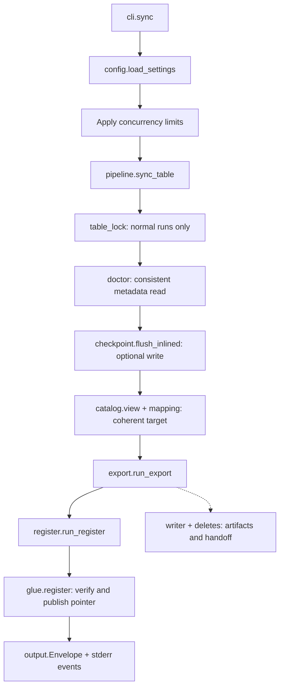
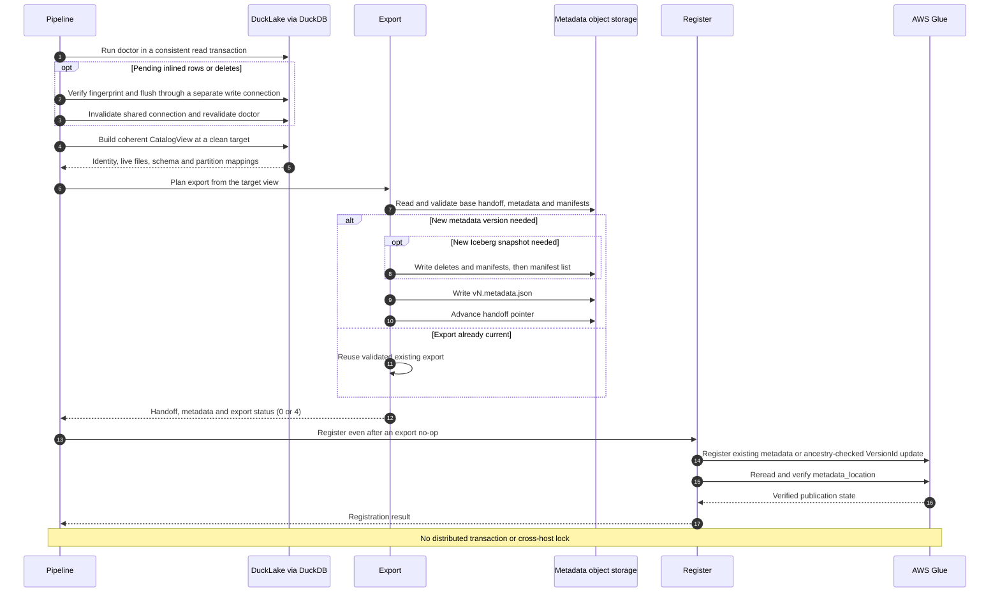
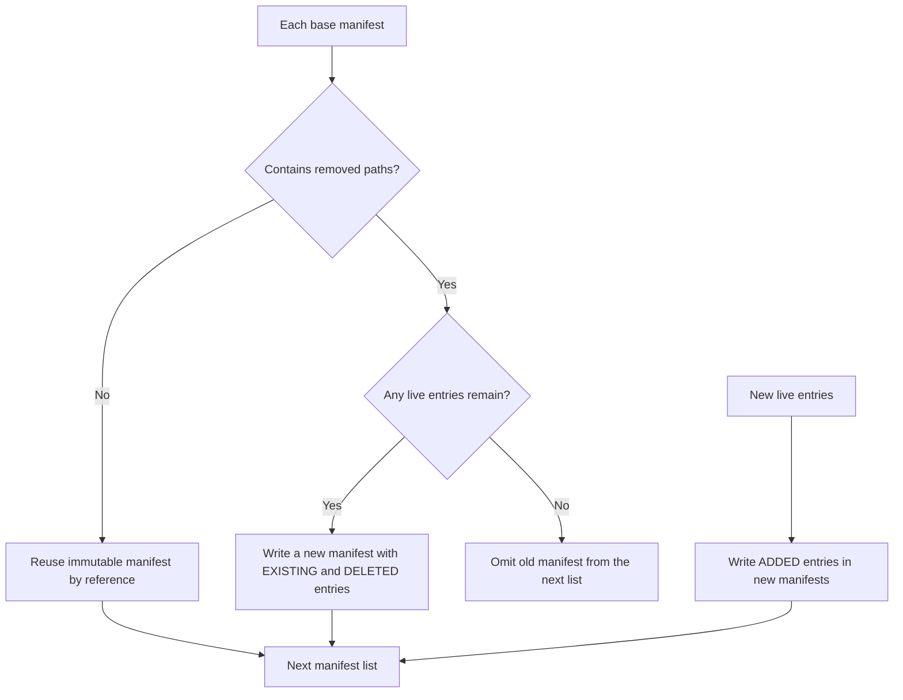
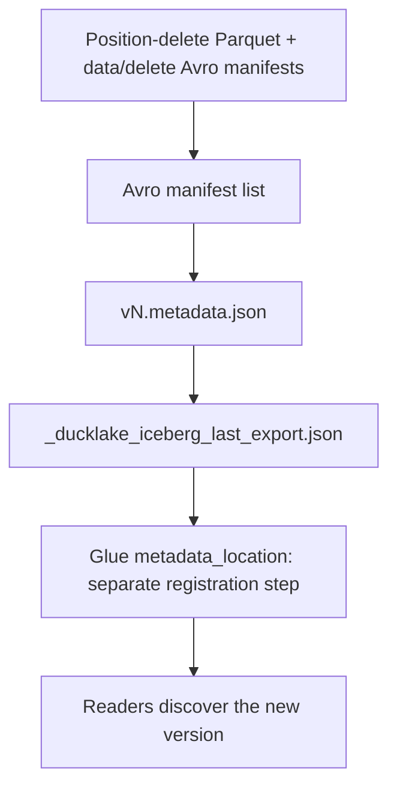

# Architecture and implementation flow

[Documentation home](README.md) | [Class reference](implementation.md) | [Compatibility](compatibility.md)

## Package boundaries



This is the module-level normal-run path; dry-run and failure branches are
described below. Registration consumes the validated export handoff rather
than reopening the DuckLake source.

| Area | Owns | Does not own |
| --- | --- | --- |
| `catalog/` | DuckDB connections, source identities, path resolution, live-file enumeration and consistent catalog view | Glue updates |
| `doctor/` | Compatibility findings and dependency-ordered rule execution | Source repair |
| `checkpoint/` | Inlined-data detection and table-scoped flush | Compaction, expiry, cleanup |
| `mapping/` | Type/schema/partition translation and evolution validation | S3 uploads |
| `deletes/` | Visibility/position validation, conversion, position-delete writing and manifest checks | Source-data rewrite |
| `writer/` | File statistics, Avro, incremental manifests, metadata, sequences and counters | Assigning unrelated source field IDs |
| `export.py` | Plan and build the next mirror state; write metadata/delete artifacts and handoff | Glue publication or source data copies |
| `register.py`, `glue.py` | Resolve handoff, check coherence/ancestry and publish metadata pointer | DuckLake catalog reads |
| `sync/` | Local process lock and persisted state vocabulary | A distributed scheduler |
| `obs/`, `timing.py`, `concurrency.py`, `aws.py` | Instrumentation, worker context, credential/client reuse | An always-running service |

The code is intentionally function-oriented. Most classes are immutable
records, result models, enums, exceptions or rule implementations, not
long-lived service objects.

## Lifecycle of one invocation

The sequence below follows a successful **normal** run. A no-op export still
reaches registration; a schema/spec-only change can skip snapshot artifacts.
Error and divergence paths stop instead of following the success arrows.



### 1. Parse, validate and prepare

Typer parses the command in [`cli.py`](../src/ducklake_iceberg/cli.py).
Only supplied settings flags override YAML/env. Configuration failures become
redacted problems. Logging gets a run ID and stderr handler. Worker limits
are reconciled and installed before PyIceberg initializes its executor.

`sync_table()` resolves the qualified name, binds table context and collects
metrics. Normal runs acquire a non-blocking local per-destination `flock`.
Dry runs skip that lock.

`_SharedCatalog` opens a metadata-only READ_ONLY DuckDB connection on demand.
The wrapper loads only the extensions needed for that operation/backend;
metadata-only reads do not need S3 credentials.

### 2. Run doctor on one consistent source view

The table identity and target snapshot are resolved inside a read
transaction. The rule framework constructs a dependency plan, not just
registration order. A blocker/error skips dependent rules; independent rules
can still report their findings.

Before the flush, `inlined-data` is an auto-remediable gate. Other blockers
stop the pipeline with exit 2. Rule errors stop with exit 1. The source is
not modified to repair arbitrary findings.

### 3. Flush only when needed

`flush_inlined()` first detects pending inserts/deletes in READ_ONLY mode,
checks nested VARIANT and records a `CatalogFingerprint`. If there is no
pending data, no write connection is opened.

When necessary, it opens a separate writable DuckLake connection, checks that
the catalog fingerprint still matches, and calls the table-scoped
`ducklake_flush_inlined_data`. Recognized transaction conflicts are retried.
It closes the write connection even on failure.

The shared read connection is invalidated after a write and doctor runs
again at the export target. This avoids validating one snapshot and exporting
a different, newly exposed incompatible state.

In dry-run mode, pending inlined rows/deletions are reported but not flushed;
export planning cannot invent the future physical files.

### 4. Select and validate the export target

[`catalog/view.py`](../src/ducklake_iceberg/catalog/view.py) collects a
`CatalogView` in a read transaction:

1. Resolve table ID, UUID, table schema version and snapshot.
2. Select the most recent snapshot without pending inlined data, never
   regressing behind the already exported checkpoint.
3. Reject an unresolved inlined-data gap that would omit rows.
4. Enumerate live files from catalog tables and cross-check
   `ducklake_list_files`.
5. Build the schema and all partition specs/typed values with stable IDs.
6. Collect source change tokens and validate whether the history window is
   complete before using absence of changes as proof.

A writer may commit more inlined rows between flush and export. Those rows
must remain pending for a subsequent run, not disappear from the mirror's
claimed checkpoint. See `test_export_concurrent_inlined.py`.

### 5. Load the base and compute a set difference

The export pointer identifies the last generated `metadata.json`. The base
snapshot's manifests describe the previous live state.

Data-file identity is its canonical path. Delete identity is a deterministic
source/group key encoded in generated delete names. The current exporter
consolidates delete inputs per partition/spec group; it does not blindly
reconvert every unchanged delete on each run.

```text
added   = desired live keys - base live keys
removed = base live keys - desired live keys
```

Snapshot begin/end ranges alone are insufficient: source compaction and
history expiration can remove older catalog records. The desired live-file
set is therefore compared against manifests, rather than assuming a change
log is complete.

The exporter verifies base/source identity, existing metadata lineage,
schema evolution and initial-default compatibility before publishing.
An unchanged table returns exit 4 with the handoff so Glue repair can still
run.

### 6. Build immutable artifacts

Statistics come from catalog rows when available, otherwise footers. Existing
manifests are read concurrently; new data statistics and delete conversions
are bounded by their configured pools.

For each old manifest:

- No removed paths: reuse the manifest by reference.
- Removed paths: rewrite a new manifest with remaining entries as `EXISTING`
  and removed entries as `DELETED`.
- No live entries left: omit it from the next list.

New entries are `ADDED`. Data and deletes have separate manifests. Original
sequence/snapshot information is preserved for existing/deleted entries;
new entries inherit the new snapshot's v2 sequences. Position-delete
sequences must reach the data they delete.



Apply this decision separately to data and delete manifests. Omission from
the new list does not physically delete an old manifest or its source files.

The reconstructed live set is checked against the desired set before the
manifest list is published. Counters and operation classification are
validated rather than inferred from the last SQL statement alone:

| Iceberg operation | Meaning here |
| --- | --- |
| `append` | Only new data files |
| `delete` | No new data; qualifying removals/deletes |
| `overwrite` | Mixed modifications, including common update/merge/cumulative-delete replacement cases |
| `replace` | Proven source compaction-only change: same rows in different files |

A schema/spec-only update can skip new snapshot files and write only the
next metadata version. For normal file changes, writes are ordered as:



Artifacts are immutable; the handoff JSON is the operational overwrite.
Dry-run returns after planning/statistics and before these writes. Advancing
the handoff marks a completed **export**; only the later Glue update changes
the table version discovered by readers.

### 7. Publish to Glue, even after an export no-op

[`register.py`](../src/ducklake_iceberg/register.py) accepts the in-memory
handoff/metadata from the same sync, avoiding redundant S3 reads. It does not
open DuckDB or inspect source Parquet.

[`glue.py`](../src/ducklake_iceberg/glue.py) creates the database if needed
and registers the existing metadata file with PyIceberg's `register_table`,
not `create_table` (which would reassign IDs).

For an existing table:

- Exact metadata-location match: already registered, exit 4.
- Existing pointer is an ancestor in the new metadata log: update using
  `VersionId` optimistic locking.
- Unrelated pointer/source: divergence, exit 3.
- Same-named non-Iceberg table: explicit error, never replacement.

Registration is reread to verify the resulting location. Transient errors
have bounded retries; access/validation errors are not blindly retried.
The broader retry/reconciliation primitives are documented separately from
the active registration path in the class reference.

An export exit 4 **does not stop registration**. A prior run might have
written all metadata but failed before advancing Glue.

### 8. Emit results and clean process resources

The envelope contains stage outcomes, effective redacted settings, metrics
and problems. `sync.end` and `command.end` events summarize results.
Connections and locks are released; logging state is reset. Sessions,
clients and FileIO may be reused within the process, with explicit reset
helpers for tests.

## Storage layout and sources of truth

For `analytics.orders`:

```text
s3://example-lake/ducklake/...                 existing source data/deletes
s3://example-lake/iceberg/analytics/orders/
  metadata/
    <unique manifests and manifest lists>.avro
    v1.metadata.json
    v2.metadata.json
  deletes/
    <source-group-key>-<uuid>-deletes.parquet
  _ducklake_iceberg_last_export.json
```

The exact generated Avro names are implementation details; follow metadata,
not a filename guess.

| State | Authority |
| --- | --- |
| Which source files/rows exist at the source checkpoint | DuckLake catalog plus validated files |
| Which generated export is ready for registration | Handoff pointer and validated metadata lineage |
| What readers currently see | Glue's `metadata_location` |
| Source provenance/checkpoint of an Iceberg version | `ducklake.*` / `ducklake_iceberg.*` table properties and snapshot summary |
| Is a same-host sync running? | Kernel-held local lock, not mere presence of its JSON file |

The pointer is not `version-hint.text`; this is not a parallel Hadoop catalog.
Registration never lists `metadata/` and picks the largest filename.

## Failure and concurrency boundaries

There is no cross-system transaction. Partial exports can leave unreferenced
immutable artifacts. A missing pointer after a completed next metadata file
is recovered only when successor ancestry is proven; arbitrary files are
not adopted. A completed export with failed registration is retried by a
subsequent normal sync.

Local locks do not protect two ECS tasks/hosts. Glue CAS protects the catalog
pointer update, not simultaneous writes to a shared export prefix. Operate
one writer/schedule per destination table.

Snapshot retention prunes metadata history, not objects; source cleanup is
external. Removing a data file still referenced by an Iceberg snapshot breaks
that snapshot. There is no `clean` CLI to repair this.

## Maintainer invariants

Preserve zero-copy, original field IDs, consistent read transactions,
validated snapshot visibility, immutable artifacts, data/delete manifest
separation, sequence inheritance, summary/live-set reconstruction, explicit
divergence and secret redaction. Tests named in the
[class reference](implementation.md) and [testing guide](testing.md) make
these contracts executable.
