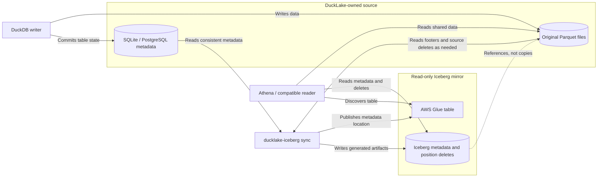
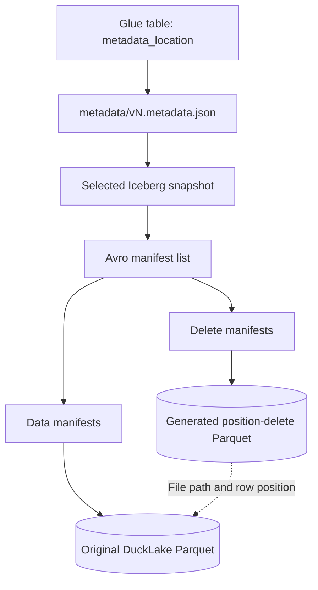

# Concepts: from files to a shared table

[Documentation home](README.md)

## The problem this repository solves

Suppose DuckDB writes an orders table using DuckLake. An analyst wants to
query it with Athena. Giving Athena a directory of Parquet files is not
enough: which files are current, which rows were deleted, and what did a
renamed column used to mean?

This project translates the **table metadata** into Iceberg's representation
and publishes the resulting metadata location in Glue. Athena can discover
an Iceberg table while DuckDB continues managing the original DuckLake table.
Both representations point at the same underlying data files.

This is **asynchronous, one-way replication of metadata**, not a shared
transaction manager. A DuckLake commit becomes visible in the Iceberg mirror
only after a successful sync and publication.



Arrows show access and references, not a bulk data-copy pipeline. The optional
inlined-data flush can also write **new** source files, as explained below.

## The vocabulary

| Concept | Meaning | Role here |
| --- | --- | --- |
| Object storage | Storage of named objects such as `s3://bucket/orders/part.parquet`; not a SQL database | Holds existing data and newly generated Iceberg artifacts |
| Parquet | A column-oriented file format with typed columns, row groups and statistics in its footer | Stores data rows and position-delete rows |
| Table format | Rules describing which files form a table and how schema/history/deletes work | DuckLake is the source format; Iceberg v2 is the mirror format |
| Catalog | A service/database for locating tables and recording metadata | DuckLake stores metadata in SQLite/PostgreSQL; Glue points to Iceberg metadata |
| Query engine | Software that reads table metadata and files to execute SQL | DuckDB writes/reads DuckLake; compatible engines read the mirror |
| Lakehouse | Database-like tables and transactions over files in a data lake | Both formats provide table semantics over Parquet |
| Snapshot | A committed view of a table/catalog at a particular point in history | The sync selects a consistent DuckLake target and represents its live files |
| Schema | Column names, types, nullability and stable field identities | Translated without reassigning DuckLake column IDs |
| Partition specification | Rules dividing files into groups based on column values/transforms | Translated only when semantics are safe |
| Manifest | An Iceberg Avro file describing data/delete files and their status/statistics | Written by this project's metadata writer |
| Manifest list | An Avro index of the manifests belonging to an Iceberg snapshot | Lets a reader find the snapshot's files |
| `metadata.json` | Iceberg's top-level table description: schemas, specs, snapshots and properties | Glue's `metadata_location` points here |

## DuckDB is not DuckLake

[DuckDB](https://duckdb.org/) is an analytical SQL database engine that can
run inside a Python process. Extensions add capabilities.

[DuckLake](https://ducklake.select/) is a table format and DuckDB extension.
It stores metadata in a transactional SQL database and stores table data
in Parquet files. The metadata database is not the same thing as the Parquet
directory.

For example:

```text
DuckDB process
  attaches DuckLake as "lake"
    metadata database: PostgreSQL "lake"
    physical data: s3://example-lake/ducklake/
```

In this project, `catalog_alias` names the attached DuckLake database.
`metadata_catalog` separately names its exposed metadata database, whose
`ducklake_*` tables the implementation reads. Neither is the Glue database
name.

### Why small inserts can require a flush

DuckLake may keep small inserted rows or pending deletes **inside its metadata
database** instead of immediately writing Parquet. These are *inlined* rows.
An Iceberg reader cannot read those SQL metadata rows.

The sync's checkpoint stage invokes DuckLake's `ducklake_flush_inlined_data`
for the selected table. This writes new source Parquet/delete files. It does
not compact or rewrite existing source data files. Therefore "zero-copy"
does **not** mean that a normal sync has no source write permissions at all:
the inlined-data flush is the deliberate exception.

## What Iceberg contributes

[Apache Iceberg](https://iceberg.apache.org/) is an open table format, not a
query engine and not an AWS service. Its readers follow a metadata graph:



The project writes this graph itself. PyIceberg supplies models, serializers
and readers, but its normal "create a table and add files" path would not
preserve all required DuckLake identities and internal-file conventions.

### Field IDs are more important than column names

Imagine that `customer_name` has field ID 7 and is renamed to `name`.
Older Parquet files still use the old physical name. A reader must know that
ID 7 still represents the same logical field. Creating an Iceberg table from
scratch and assigning unrelated IDs could make existing values read as null.

The schema mapper preserves DuckLake's `column_id` as Iceberg's field ID,
including children of structs, list elements, and map keys/values. Renames
and drops are interpreted through these IDs, not name matching.

### Partitions are an optimization, not the table's rows

A partition might represent one day of timestamps or one bucket of IDs.
Readers use partition metadata and file statistics to skip files that cannot
match a predicate. Incorrect partition metadata is worse than none: it can
cause a reader to skip files containing matching rows.

DuckLake's calendar `year` and Iceberg's `year` do not mean the same thing.
The mapper degrades unsafe transforms to an unpartitioned spec and emits a
warning rather than inventing equivalent semantics. Queries still see the
data, but pruning may be weaker. See [Compatibility](compatibility.md).

### How a deletion works without rewriting the source file

A position delete records a data file's path and a zero-based row position:

```text
file_path                              pos
s3://example-lake/ducklake/part.parquet  3
```

The original file still exists. The reader excludes row 3 when reading the
relevant snapshot. DuckLake's deletion representation is validated and
converted into Iceberg position deletes. `UPDATE` and `MERGE` can combine
new data files with deletes of older rows.

Do not equate the manifest's `total-records` with the number of visible
rows: physical records and deleted positions are tracked separately.

## What AWS Glue and Athena do

**AWS Glue Data Catalog** stores table discovery information, including the
location of the current Iceberg metadata file. It does not store the data
rows. A "Glue table" here is catalog metadata, not an ETL job.

**Amazon Athena** is an example of a SQL reader that uses Glue and accesses
S3. It needs its own permissions and query-result location. Publishing this
mirror does not configure an Athena workgroup, S3 bucket or network.

The first publication registers an existing Iceberg metadata file.
Subsequent publications advance Glue's pointer with optimistic locking
(`VersionId`) and verify the resulting location.

## Zero-copy, ownership and consistency

- DuckLake owns the data, source schema and maintenance.
- The sync owns the Iceberg metadata/delete-artifact prefix.
- Other engines are readers, not writers, of the mirror.
- The sync does not create independent data copies or compact the source.
- New Iceberg artifacts are immutable; the handoff pointer is overwritten.
- A completed export is not yet a published table until Glue is updated.
- There is no distributed transaction encompassing DuckLake, S3 and Glue.
  Recovery is designed around the ordered writes and validated pointers.
- Source file cleanup must not remove files still referenced by retained
  Iceberg snapshots.

A successful sync is a checkpoint, not a continuously updated view. Choose a
schedule based on acceptable lag. Start with the
[local exercise](getting-started.md#local-exercise-without-aws), then read the
[architecture](architecture.md) for exact publication and recovery boundaries.

## Ingestion and publication cadence

The design separates three operations with distinct timing.

1. **Commit.** DuckLake makes the new state queryable through DuckDB,
   including eligible small batches stored inline in the catalog. A CDC
   consumer can record its source position alongside the changes in the
   same transaction.
2. **Materialize.** A flush writes pending inlined changes to source files.
   Buffering eligible writes can reduce small-file creation, depending on
   the volume between flushes and how the table is partitioned. Sync flushes
   pending inlined changes when required for publication.
3. **Publish.** Sync validates the source file set, writes Iceberg v2 metadata
   and any required position deletes, and updates AWS Glue. Compatible readers
   query the published snapshot using the same source Parquet data files.

Direct DuckLake readers need access to the source catalog and data. Iceberg
readers discover the published metadata through Glue and need access to the
files referenced by that snapshot. Keeping those files available allows
readers to query the published snapshot during a DuckLake catalog outage.

This pattern fits tables where operational consumers need committed state
before the next analytical snapshot. Measure transaction commit time,
source-to-reader freshness, and query response time separately. Iceberg
freshness depends on the cadence and success of publication. Source
maintenance must account for files referenced by retained Iceberg snapshots,
including during publication delays. See [retention and maintenance](operations.md#retention-and-maintenance)
for the operational requirements.

## Further reading

- The architecture article describes the separate cadences and an AWS CDC
  proof of concept. With ingestion every minute and publication every
  15 minutes, measured p95 end-to-end freshness was about 80 seconds through
  DuckLake and 16 minutes through the Iceberg readers. Costs were similar to
  the 15-minute Iceberg batch baseline for that workload.
  [Ingest Like a Database, Publish Like a Lakehouse](https://medium.com/@didone/ingest-like-a-database-publish-like-a-lakehouse-b19b30f396b8)
- The walkthrough uses Aurora PostgreSQL for the DuckLake catalog, S3 for
  data and generated metadata under separate prefixes, and Glue for table
  discovery. It publishes three orders and checks them in Athena, then
  updates, deletes, and inserts rows in DuckLake. The next successful sync
  makes the changed state visible in Athena.
  [DuckLake Is Great for Small Writes. But Can My Analytics Tools Read It?](https://medium.com/@didone/ducklake-is-great-for-small-writes-but-can-my-analytics-tools-read-it-09463403d5ff)
