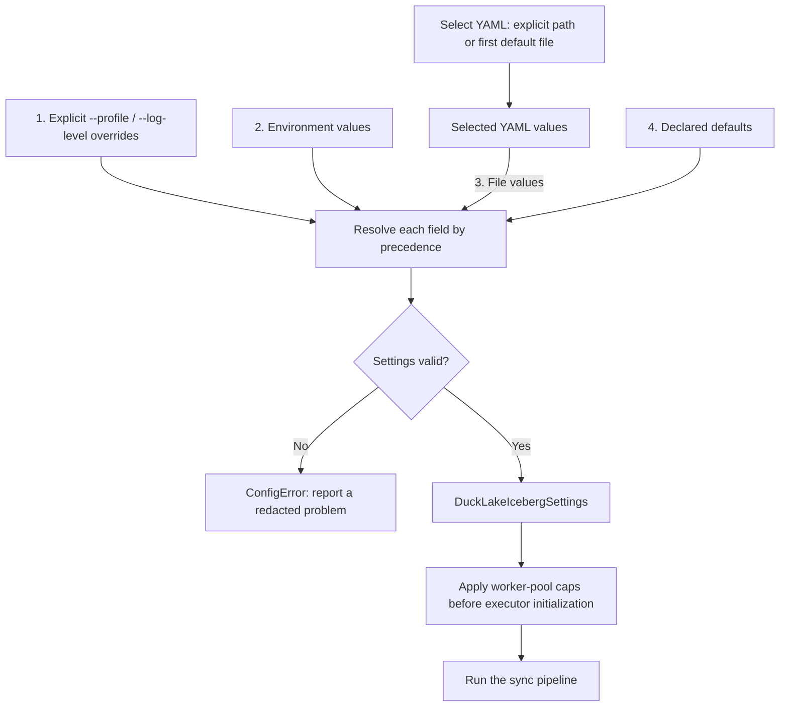

# Complete configuration reference

[Documentation home](README.md) | [CLI](usage.md) | [Deployment](deploy/README.md)

The schema and validators live in
[`config.py`](../src/ducklake_iceberg/config.py), in
`DuckLakeIcebergSettings`. Unknown YAML keys are errors, not ignored options.
Settings are validated before the sync starts.

## Resolution order

For a setting, precedence is:

1. An explicitly supplied CLI override (`--profile` or `--log-level`).
2. Its environment variable.
3. The selected YAML file.
4. The declared default.

YAML selection is a separate process, in this order:

1. `--config /path/to/file.yaml`.
2. `DUCKLAKE_ICEBERG_CONFIG_FILE`.
3. `./ducklake-iceberg.yaml`.
4. `./ducklake-iceberg.yml`.
5. `~/.config/ducklake-iceberg/config.yaml`.
6. No YAML file.

An explicit path that does not exist fails; it does not fall back to another
file. An empty YAML file is allowed, but required settings must still come
from another source. YAML must be a mapping. The settings source does **not**
load `.env` files or Pydantic file-secret directories automatically. A
scheduler/Docker `--env-file` can inject environment variables externally.

Environment names are case-insensitive. For all ordinary fields, uppercase
the field name and prepend `DUCKLAKE_ICEBERG_`. For example:

```bash
export DUCKLAKE_ICEBERG_MAX_IO_WORKERS=4
export DUCKLAKE_ICEBERG_SNAPSHOT_RETENTION_HOURS=24
```

`pyiceberg_max_workers` has special aliases described below. `--table`,
`--json`, `--dry-run`, and `--log-format` are invocation controls, not settings
fields; they have no equivalent YAML key in this application.



The numbers are priority, not execution order. An invalid higher-priority
value fails validation instead of falling back to a lower-priority source.
Selecting an explicit nonexistent YAML path also fails before this merge.

## Every settings field

`Required` means no default. `null` means unset, not an empty string.
The YAML key and the environment suffix are shown together; the prefix
above applies unless an exception is stated.

### Source catalog and storage

| YAML key / environment suffix | Type and default | Meaning, validation and implementation |
| --- | --- | --- |
| `catalog_dsn` / `CATALOG_DSN` | string; **required** | Existing DuckLake attachment DSN. Must start with `ducklake:`. `user=`, `password=` and `pwd=` are forbidden case-insensitively. Used by `DuckLakeConnection._attach()` in [connection.py](../src/ducklake_iceberg/catalog/connection.py), including the separate write connection for a flush. |
| `catalog_alias` / `CATALOG_ALIAS` | string; `lake` | Alias used in DuckDB `ATTACH` and DuckLake function calls; not a destination namespace. Must match `^[A-Za-z_][A-Za-z0-9_]*$` and differ from `metadata_catalog`. Used by connection, reader, checkpoint and provenance code. |
| `metadata_catalog` / `METADATA_CATALOG` | string; `lake_meta` | `ATTACH ... (METADATA_CATALOG ...)` name exposing `ducklake_*` SQL tables. Same identifier validation as the alias. Used by catalog readers, doctor rules, mappings, checkpoint and delete enumeration. |
| `data_path` / `DATA_PATH` | string; **required** | Root of the existing source Parquet files. Accepts `s3://bucket/key` or an absolute local path; normalized to one trailing `/`. S3 requires both bucket and nonempty key. Used for path resolution, S3 credential decisions, identity/coherence checks and rejecting metadata inside source data. It does **not** create or relocate the source lake, nor add a `DATA_PATH` override to the runtime ATTACH. |
| `iceberg_metadata_prefix` / `ICEBERG_METADATA_PREFIX` | string; **required** | Root under which export appends `/<glue_database>/<normalized_table>`. Same location validation as `data_path`; either prefix containing the other is forbidden. Used by [export.py](../src/ducklake_iceberg/export.py) and [register.py](../src/ducklake_iceberg/register.py). Full CLI publication through Glue requires S3; local paths are for export/development/tests. |

Tested DSN forms:

```yaml
catalog_dsn: "ducklake:sqlite:/absolute/path/catalog.sqlite"
# Or:
catalog_dsn: "ducklake:postgres:dbname=lake host=pg.internal port=5432"
```

Relative paths, `file://` settings values and a bare `s3://bucket` are not
accepted by the settings location validator, even though some lower-level
metadata helpers also understand `file://`.

### AWS, endpoints and logging

| YAML key / environment suffix | Type and default | Meaning, validation and implementation |
| --- | --- | --- |
| `glue_database` / `GLUE_DATABASE` | string; **required** | Destination Glue database; only lowercase ASCII letters, digits and underscores, length 1-255. Used in destination paths, `GlueTarget`, lock keys and handoff pointers. Registration creates it if missing, subject to permissions. Source schema names do not override it. |
| `aws_region` / `AWS_REGION` | string; **required** | Region for boto3/Glue and S3 properties/secrets. Syntactically validated with `^[a-z]{2}(-[a-z]+)+-\d$`; validation does not check whether a service exists there. Used by [aws.py](../src/ducklake_iceberg/aws.py), `build_file_io()` and `GlueTarget`. This application setting differs from standard `AWS_REGION` because it has the `DUCKLAKE_ICEBERG_` prefix. |
| `aws_profile` / `AWS_PROFILE` | string or null; `null` | Explicit boto3 profile; `--profile` overrides it. If null, boto3's normal credential chain applies, including standard `AWS_PROFILE`. Credentials are resolved consistently for Glue, PyIceberg FileIO and the DuckDB S3 secret. Missing/expired profiles fail explicitly; see [aws.py](../src/ducklake_iceberg/aws.py). |
| `s3_endpoint` / `S3_ENDPOINT` | string or null; `null` | Custom `http://host[:port]` or `https://host[:port]` endpoint, e.g. MinIO. Requires HTTP(S) and a network location; trailing slash removed. Passed as `s3.endpoint` to PyIceberg and as host/SSL/path-style options to the credential-backed DuckDB S3 secret. Does not change the Glue endpoint. Use a host endpoint, not a credential-bearing URL. |
| `log_level` / `LOG_LEVEL` | `DEBUG`, `INFO`, `WARNING`, `ERROR`; `INFO` | Application logging threshold. `--log-level` overrides it. Used by `cli.sync()` and [obs/logging.py](../src/ducklake_iceberg/obs/logging.py). The value is an uppercase enum, even though environment variable names are case-insensitive. |

For MinIO, provide credentials accepted by that store through the standard
AWS credential environment variables. `s3_endpoint` is not an authentication
mechanism. The DuckDB endpoint option is installed on the static-secret path
after boto3 resolves credentials; do not rely on an unauthenticated endpoint
being applied by the fallback credential chain.

For a simulated Glue endpoint such as LocalStack or moto server, set
`AWS_ENDPOINT_URL_GLUE` as a standard SDK environment variable. Setting only
`s3_endpoint` still uses real AWS Glue. Reader applications also need their
own endpoint/credential configuration.

### Statistics, retention and resource limits

| YAML key / environment suffix | Type and default | Meaning and consumer |
| --- | --- | --- |
| `stats_source` / `STATS_SOURCE` | `catalog` or `footer`; `catalog` | Statistics for newly added data files. `catalog` reads `ducklake_file_column_stats` and falls back to a footer when file stats are unavailable. `footer` reads Parquet footers. Used by `export._build_added_data_files()`, [writer/catalog_stats.py](../src/ducklake_iceberg/writer/catalog_stats.py) and [writer/stats.py](../src/ducklake_iceberg/writer/stats.py). Catalog mode does not promise zero S3 GETs: metadata, deletes and initial-default checks may still require reads. |
| `snapshot_retention_hours` / `SNAPSHOT_RETENTION_HOURS` | integer >= 1 or null; `null` | On a changed export, drop older Iceberg snapshot/log entries beyond this age while retaining the current snapshot and the immediately needed metadata lineage. Null keeps history. Converted to milliseconds in export and consumed by `writer.metadata.build_next_metadata()`. Does not delete objects or configure DuckLake maintenance; an unchanged run does not perform standalone expiry. |
| `max_footer_workers` / `MAX_FOOTER_WORKERS` | integer >= 1; `8` | Upper size of footer/statistics read pools. Used by export stats, initial-default field-ID checks and `concurrency.footer_workers()`. Reduced to `max_total_workers` when larger. |
| `max_io_workers` / `MAX_IO_WORKERS` | integer >= 1; `8` | Upper size of I/O pools for manifest reads/uploads and delete conversions. Used through `concurrency.io_workers()` by writer/export helpers. Reduced to `max_total_workers` when larger. |
| `max_total_workers` / `MAX_TOTAL_WORKERS` | integer >= 1; `32` | A cap applied **to each configured pool**, not a shared semaphore or a guarantee about total OS threads across simultaneous pools/processes. `Limits.capped()` reconciles footer, I/O and PyIceberg limits; reductions generate `workers_capped` warnings. Does not cap DuckDB threads. |
| `duckdb_threads` / `DUCKDB_THREADS` | integer >= 1 or null; `null` | `SET threads` on each opened DuckDB connection. Null leaves the DuckDB default. Separate from Python worker counts. Used by `DuckLakeConnection.open()`. |
| `duckdb_memory_limit` / `DUCKDB_MEMORY_LIMIT` | string or null; `null` | Passed to DuckDB `SET memory_limit`, e.g. `"512MB"` or `"1GB"`. DuckDB validates the string when connecting. Not an overall process memory bound; Arrow/Python allocations are separate. |
| `pyiceberg_max_workers` | integer >= 1; `8` | Special environment names: **`PYICEBERG_MAX_WORKERS`** or `DUCKLAKE_ICEBERG_PYICEBERG_MAX_WORKERS` (first alias wins if both are set). CLI limits are applied before PyIceberg's singleton executor is first used. Effective value is written back to `PYICEBERG_MAX_WORKERS` by `concurrency.apply_limits()`. No dedicated CLI flag. |
| `duckdb_extension_directory` / `DUCKDB_EXTENSION_DIRECTORY` | string or null; `null` | Passed as `extension_directory` directly to `duckdb.connect()` before any `INSTALL`/`LOAD`. Points at preinstalled extensions for a read-only HOME/offline runtime. Null uses DuckDB's default. The unprefixed `DUCKDB_EXTENSION_DIRECTORY` variable is not the application's setting and has no effect in the pinned DuckDB version. |

Set DuckLake's source-file cleanup retention **longer** than every Iceberg
snapshot you expect to query, plus a margin for scheduling lag and running
queries. A null Iceberg retention means unbounded history: do not pair it
with finite source cleanup and expect historical snapshots to stay readable.

## Complete YAML example

This lists every application settings field. It is an example, not a claim
that these resources already exist:

```yaml
catalog_dsn: "ducklake:postgres:dbname=lake host=pg.internal port=5432"
catalog_alias: "lake"
metadata_catalog: "lake_meta"
data_path: "s3://example-lake/ducklake/"
iceberg_metadata_prefix: "s3://example-lake/iceberg/"
glue_database: "analytics"
aws_region: "us-east-1"
aws_profile: null
s3_endpoint: null
log_level: "INFO"
stats_source: "catalog"
snapshot_retention_hours: 24
max_footer_workers: 8
max_io_workers: 8
max_total_workers: 32
duckdb_threads: 2
duckdb_memory_limit: "1GB"
pyiceberg_max_workers: 8
duckdb_extension_directory: null
```

The non-null memory/thread/retention values above are deliberate choices,
not the defaults. In containers, leave `aws_profile` null and use the task
role; normally retain the image's embedded extension-directory setting.

## Other environment variables and operational controls

These are **not additional YAML keys**:

| Variable/control | Purpose and implementation |
| --- | --- |
| `DUCKLAKE_ICEBERG_CONFIG_FILE` | Explicit YAML selection in `resolve_config_file()` |
| `DUCKLAKE_ICEBERG_STATE_DIR` | Writable local state root; locks are stored in `<root>/locks`; [sync/lock.py](../src/ducklake_iceberg/sync/lock.py) |
| `XDG_STATE_HOME` | If no state root: locks in `$XDG_STATE_HOME/ducklake-iceberg/locks` |
| `HOME` | Final lock fallback: `$HOME/.local/state/ducklake-iceberg/locks`; also used by standard profile/extension conventions |
| `DUCKLAKE_ICEBERG_TIMINGS` | Adds detailed `timings` to the envelope. [timing.py](../src/ducklake_iceberg/timing.py) enables it unless the value is exactly empty, `0` or `false`. |
| `AWS_ACCESS_KEY_ID`, `AWS_SECRET_ACCESS_KEY`, `AWS_SESSION_TOKEN` | Standard SDK credential inputs; use temporary workload credentials rather than committing values |
| `AWS_PROFILE`, `AWS_CONFIG_FILE`, `AWS_SHARED_CREDENTIALS_FILE` | Standard boto3 profile/credential-file selection when applicable |
| `AWS_ENDPOINT_URL_GLUE` | Standard SDK Glue endpoint override for development/emulation |
| `AWS_EC2_METADATA_DISABLED` | Standard SDK option to disable instance-metadata discovery for local non-EC2 tests; do not disable a credential provider your deployment needs |
| `PGHOST`, `PGPORT`, `PGDATABASE`, `PGUSER`, `PGPASSWORD`, `PGSSLMODE` | libpq inputs consumed by the PostgreSQL extension. DSN connection details can supply host/port/database; credentials stay outside it. Use TLS appropriate to your server and secret injection. |
| `DUCKLAKE_ICEBERG_MINIO_IMAGE` | **Tests only**: overrides the MinIO image in `tests/integration/test_e2e_minio.py` |

Docker build arguments (`VERSION`, `REVISION`, `SOURCE`, `CREATED`,
`POETRY_VERSION`) describe/build the image; they are not sync settings. See
[Deployment](deploy/README.md#image-build-and-runtime-settings).

## Validate and inspect safely

There is no standalone `config` command. A dry-run validates settings and
then attempts real reads:

```bash
ducklake-iceberg sync --table sales.orders --config ./ducklake-iceberg.yaml \
  --dry-run --json --log-format json
```

For **settings validation only**, without running stages:

```python
from pathlib import Path

from ducklake_iceberg.config import load_settings

settings = load_settings(config_file=Path("ducklake-iceberg.yaml"))
print(settings.redacted())
```

`redacted()` includes the resolved file path and replaces the DSN host.
Envelope/log rendering additionally scrubs secret-like content. This is
defense in depth, not permission to store credentials in arbitrary settings.
Do not print raw credential properties or connection secrets when debugging.
Programmatic construction can use `DuckLakeIcebergSettings(...)` directly,
but environment sources still apply and direct construction does not choose
a YAML file for you.
