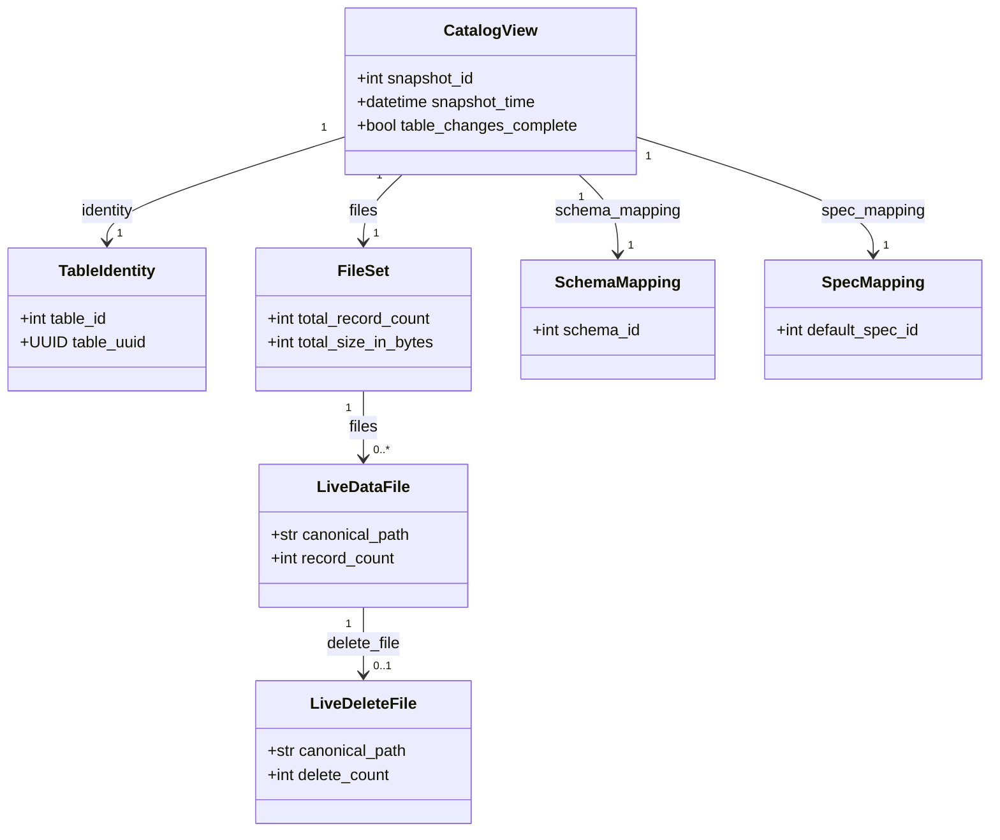
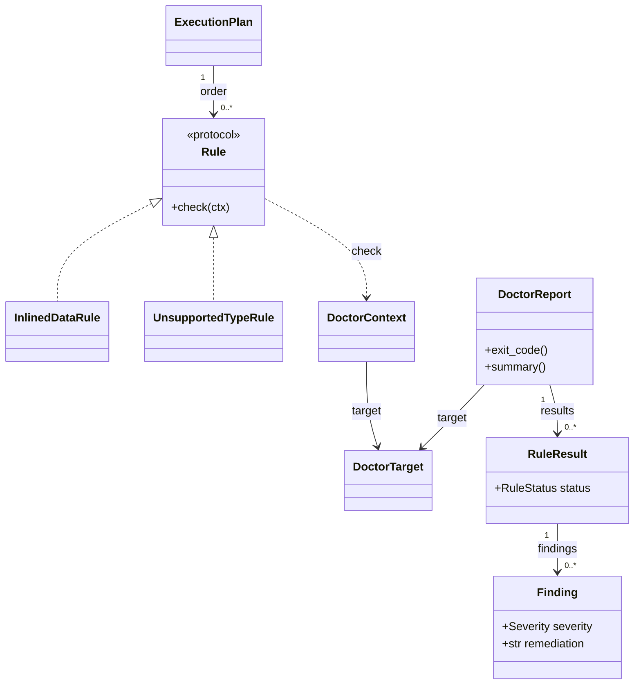

# Implementation and class reference

[Documentation home](README.md) | [Architecture](architecture.md) | [Testing](testing.md)

This reference covers the classes **defined by this repository under `src/`**,
including private helpers. Imported PyIceberg, PyArrow, boto3 and standard
library classes belong to their upstream APIs. Test-only harnesses are
explained in [Testing](testing.md#fixtures-and-test-doubles).

Most records are frozen dataclasses: construct them from validated inputs,
pass them between stages, and produce a new value instead of mutating them.
Mutable collectors/builders are called out explicitly. Names starting with
`_` and lower-level Python entry points are implementation details, not a
stable alternative CLI. Source links provide exact constructors, annotations
and complete field lists; the tables explain how the fields work together.

## Configuration and orchestration

### `config.py`

Source: [config.py](../src/ducklake_iceberg/config.py).
Tests: [test_config.py](../tests/unit/test_config.py).

**`DuckLakeIcebergSettings`** extends Pydantic `BaseSettings`. Its fields are
the entire [configuration reference](configuration.md#every-settings-field).
`settings_customise_sources()` implements explicit values > environment >
YAML > defaults. Field/model validators reject invalid identifiers, embedded
DSN credentials, invalid locations, overlapping prefixes and alias collisions.
`redacted()` exposes effective settings without the raw DSN host and includes
the selected config-file path. `_config_file` is private instance metadata;
`_yaml_source` is a transient class-level channel during `load_settings()`,
not a per-table business setting or a thread-safe multi-load registry.

`resolve_config_file()` selects YAML. `load_settings(config_file=...,
overrides=...)` validates it and translates Pydantic failures into
`ConfigError`. Do not bypass these validators in production by using
`model_construct()` or arbitrary unchecked copies.

### `cli.py` and `pipeline.py`

Sources: [cli.py](../src/ducklake_iceberg/cli.py),
[pipeline.py](../src/ducklake_iceberg/pipeline.py).
Tests: [test_cli.py](../tests/integration/test_cli.py),
[test_sync_e2e.py](../tests/integration/test_sync_e2e.py),
[test_dry_run.py](../tests/integration/test_dry_run.py),
[test_revalidation.py](../tests/integration/test_revalidation.py).

`cli.app` is the Typer entry point declared by `project.scripts`.
`sync()` loads settings, installs logging/limits, invokes the pipeline and
emits the envelope. `main()` calls the application for explicit Python use.
Control-flow exceptions are left to Typer; other exceptions become redacted
problems rather than tracebacks containing local credentials.

**`_SharedCatalog`** is a mutable connection owner for one sync.
`get()` lazily opens a metadata-only READ_ONLY connection; `invalidate()`
closes and clears it after a source write or stage completion. Stages borrow
the connection; they must not treat it as a new independent transaction.

`sync_table(settings, qualified, run_id=..., dry_run=..., envelope=...)`
orchestrates one table and appends results/problems to the supplied envelope.
Its private immutable `_SyncResult` carries the exit and optional typed
`ExportResult` between orchestration layers; totals and locations no longer
depend on reparsing serialized stage dictionaries. Doctor steps retain the
complete report, and any pre/post-flush error stops before export.
`problem_from_error()` preserves declared exit semantics even for lower-level
exceptions outside the main error hierarchy.

### `concurrency.py`

Source: [concurrency.py](../src/ducklake_iceberg/concurrency.py).
Tests: [test_concurrency.py](../tests/test_concurrency.py),
[test_sync_performance.py](../tests/integration/test_sync_performance.py).

| Class | State and behavior |
| --- | --- |
| `Limits` | Immutable requested/effective worker settings plus optional DuckDB thread/memory values. Constructor checks positive counts. `capped()` limits each Python/PyIceberg pool to `max_total_workers`; `capped_from(requested)` reports reductions. It is not a shared thread semaphore. |
| `ContextThreadPoolExecutor` | Extends `ThreadPoolExecutor`. `submit()` captures a distinct `contextvars` copy per task so log correlation and metrics survive worker dispatch; `map()` inherits that path. Do not share one active `Context` between workers. |

`apply_limits()` installs process state and writes `PYICEBERG_MAX_WORKERS`.
`io_workers(tasks)` and `footer_workers(tasks)` avoid oversized pools.
`worker_cursor()` scopes a DuckDB worker cursor; `reset_limits()` restores
defaults/environment for tests.

## Catalog access and target view

The following map shows selected **references between records**, not service
inheritance or data copies. Only a few identifying attributes are displayed;
the sections below explain the complete responsibilities.

### `catalog/connection.py`

Source: [connection.py](../src/ducklake_iceberg/catalog/connection.py).
Tests: [test_connection.py](../tests/integration/test_connection.py),
[test_connection_translate.py](../tests/unit/test_connection_translate.py),
[test_extension_directory.py](../tests/integration/test_extension_directory.py).

| Class | State and behavior |
| --- | --- |
| `Environment` | Diagnostic record of DuckDB version, loaded extension flags, attached catalog names, secret names and read-only state. It contains names, not secret values. Produced by `environment()`. |
| `DuckLakeConnection` | Owns one in-memory DuckDB connection attached to the existing DuckLake. Constructor receives settings plus `read_only` and `s3` controls. `open()` applies resource/extension configuration, loads required extensions, optionally creates an S3 secret, attaches the catalog and probes metadata visibility. |

Important `DuckLakeConnection` members:

| Member | Contract |
| --- | --- |
| `alias`, `meta`, `backend`, `read_only` | Connection identity/configuration |
| `raw` | Open DuckDB handle for specialized readers/rules; fails when closed |
| `execute(sql, params)` | DDL/CALL/SET without materializing results; translates DuckDB errors |
| `query_arrow(sql, params)` | Returns a `pyarrow.Table`; preserves parameter binding |
| `transaction()`, `read_transaction()` | Non-reentrant BEGIN/COMMIT scopes; rollback on escaped exceptions |
| `environment()` | Builds the diagnostic record |
| `close()`, context-manager methods | Deterministic resource release |

`open_catalog()` returns an opened wrapper. `metadata_catalog(settings, con)`
borrows a caller's connection or owns/closes a new metadata-only connection.
Only the flush deliberately opens the source without READ_ONLY.

### `catalog/reader.py`

Source: [reader.py](../src/ducklake_iceberg/catalog/reader.py).
Tests: [test_reader.py](../tests/integration/test_reader.py),
[test_reader_parse.py](../tests/unit/test_reader_parse.py).

| Class | Important fields and purpose |
| --- | --- |
| `Snapshot` | Catalog checkpoint: `snapshot_id`, time, schema version and next catalog/file IDs. It describes source metadata, not an Iceberg snapshot. |
| `TableRef` | Source schema/table name pair; `__str__()` renders a qualified name. Does not yet include a resolved table ID. |
| `TableIdentity` | Resolved ref, numeric table ID, UUID, schema ID/version, table/schema path layers and selected `Snapshot`. Used to reject source recreation/mismatched export identity. |
| `InlinedDataTable` | Metadata registration of a physical inlining table: table ID, physical name, schema version and count. Used by catalog inspection/detection helpers. |

`parse_table_ref()`, `current_snapshot()`, `snapshot_at()` and `resolve_table()`
convert operator selection into a snapshot-bound identity. A source schema,
table or snapshot missing at that point is not silently treated as an empty
table.

### `catalog/files.py`

Source: [files.py](../src/ducklake_iceberg/catalog/files.py).
Tests: [test_files.py](../tests/catalog/test_files.py).

| Class | Important fields and purpose |
| --- | --- |
| `LiveDataFile` | Validated live source file with file ID, resolved/canonical path, size, record count, partition/mapping IDs, row-ID/order information, visibility start/partial bounds and optional paired `LiveDeleteFile`. It is not a copied file. |
| `LiveDeleteFile` | Paired source delete file: ID, resolved/canonical path, size, delete count and format. The exporter converts its visible positions. |
| `PathLayers` | Root data path plus schema/table path overrides and relative/absolute flags. Preserves path resolution semantics instead of concatenating arbitrary strings. |
| `EmptyReason` | `truly-empty`, `inlined`, or `unknown`: distinguishes a legitimately empty table from a table whose rows are not in files yet. |
| `FileSet` | Tuple of live files, path layers, earliest begin snapshot, total bytes/records and optional empty reason. Shared input to mapping/planning/statistics. |
| `FileSetDivergence` | The catalog and `ducklake_list_files` disagree. Carries rendered/JSON diagnostics and exit 3; no guessed union or intersection is exported. |
| `FileEnumerationError` | Inconsistent/unreadable enumeration, exit 1. |
| `FileEnumerationBlocked` | A compatibility restriction found during enumeration, exit 2. |

`enumerate_files()` performs the two-source cross-check and pairs deletes.
`canonical()` normalizes path identity for set comparison; it is not a
relocation/copy operation.

### `catalog/view.py`

Source: [view.py](../src/ducklake_iceberg/catalog/view.py).
Tests: [test_export_concurrent_inlined.py](../tests/integration/test_export_concurrent_inlined.py),
[test_export_initial_default.py](../tests/integration/test_export_initial_default.py),
[test_export_identity.py](../tests/integration/test_export_identity.py).

**`CatalogView`** is the export's immutable resolved source input. It contains
the `TableIdentity`, snapshot ID/time, `FileSet`, `SchemaMapping`,
`SpecMapping`, per-file partition values, table change tokens, and the
snapshots where non-null initial defaults were introduced.
`table_changes_since` and `table_changes_complete` distinguish an actual
complete change window from missing/expired history.

`read_catalog()` selects a clean target, guards against pending rows,
enumerates files and builds mappings inside the caller's read transaction.
`check_initial_defaults(view, io)` selectively reads older-file field IDs and
rejects v2's silent-null mismatch.

## Checkpoint: inlined data and the only source write

Sources: [detect.py](../src/ducklake_iceberg/checkpoint/detect.py),
[model.py](../src/ducklake_iceberg/checkpoint/model.py),
[variant.py](../src/ducklake_iceberg/checkpoint/variant.py),
[flush.py](../src/ducklake_iceberg/checkpoint/flush.py).
Tests: [test_detect.py](../tests/integration/test_detect.py),
[test_checkpoint.py](../tests/integration/test_checkpoint.py),
[test_variant.py](../tests/integration/test_variant.py),
[test_checkpoint_model.py](../tests/unit/test_checkpoint_model.py).

| Class | State, method and use |
| --- | --- |
| `checkpoint.model.TableRef` | Resolved schema/table **and table ID**, unlike `catalog.reader.TableRef`. `qualified` and `__str__()` are diagnostic names; detection/flush use its stable ID. |
| `CatalogFingerprint` | Source root, format version, maximum snapshot and live table count. `matches()` / `divergence()` compare read and write attachments before a flush, detecting accidental catalog creation/identity changes. |
| `CheckpointError` | Structured failure with checkpoint code, phase/context and `to_json()`; default exit 1. |
| `NestedVariantError` | Specialized checkpoint blocker `E-VARIANT-NESTED`, exit 2; reports VARIANT nested inside a container before source writes. |
| `InlinedPhysicalTable` | Discovered physical name, data/delete kind, table/schema IDs and registered/existing flags. `to_json()` exposes detection evidence. |
| `InlinedCount` | Count for one physical table: visible versus total rows, whether visibility filtering was possible, and earliest visible begin snapshot. |
| `InlinedStatus` | Counts/warnings for a resolved table and snapshot. `pending_rows`, `pending_data_rows`, `pending_delete_rows`, `has_pending` and `earliest_pending_begin` guide flushing/target selection. |
| `VariantColumn` | Field ID/path/name, depth, parent ID/type and root ID. `is_nested` distinguishes root VARIANT from unsafe container nesting; `to_json()` supplies diagnostics. |
| `FlushResult` | Source table, rows flushed, before/after snapshots. `wrote` detects actual work; `exit_code` is 0 for work or 4 for no pending change. |

`detect_inlined()` accounts for source snapshot visibility.
`clean_snapshot()` selects a target that does not lose pending rows.
`find_variant_columns()` / `find_nested_variants()` inspect schema shape.
`flush_inlined(settings, qualified, con=...)` borrows a read connection,
opens a separate write connection only when needed, checks the fingerprint,
and retries recognized transaction conflicts. It never schedules
compaction/expiry/cleanup.

## Doctor framework and rules

Concrete rules satisfy `Rule` structurally; the dashed realization arrow
does **not** mean they inherit from a common implementation. The plan orders
rules, each rule checks the shared context, and the report collects outcomes.

The two concrete rules are examples; the table below lists all built-ins.

Sources: [model.py](../src/ducklake_iceberg/doctor/model.py),
[plan.py](../src/ducklake_iceberg/doctor/plan.py),
[registry.py](../src/ducklake_iceberg/doctor/registry.py),
[runner.py](../src/ducklake_iceberg/doctor/runner.py),
[report.py](../src/ducklake_iceberg/doctor/report.py).
Tests: [test_framework.py](../tests/doctor/test_framework.py),
[test_plan.py](../tests/doctor/test_plan.py),
[rule tests](../tests/doctor/rules),
[test_doctor_acceptance.py](../tests/integration/test_doctor_acceptance.py).

| Class | State and behavior |
| --- | --- |
| `Severity` | Ordered `INFO=10`, `DEGRADED=20`, `BLOCKER=30`; `.json` returns lowercase contract labels. |
| `RuleStatus` | `passed`, `failed`, `skipped`, `error`; a finding can be informational and still make a rule `failed`. |
| `Capability` | `POSITION_DELETES` or `NAME_MAPPING`; framework capabilities alter selected findings. Default context enables position deletes, not name mapping. These are not end-user feature flags. |
| `Finding` | Rule ID, severity, stable subject, detail, remediation and structured data. `to_json()` serializes diagnostic content; the parent rule result identifies the rule. |
| `DoctorTarget` | Attached catalog/meta names, source names/IDs, target snapshot/schema version; `qualified_name` for diagnostics. |
| `DoctorContext` | Raw DuckDB handle, target, format version and capabilities. `meta()` qualifies metadata tables safely, `bind` supplies IDs and `query()` filters/binds only parameters used by its SQL. |
| `Rule` | Structural protocol exposing read-only `id`, `title`, maximum `severity`, `remediation`, `requires` and `check(ctx) -> Sequence[Finding]`. Concrete frozen dataclasses satisfy it without inheritance. |
| `PlanError` | Invalid dependency graph/order: cycles, orphan requirements, duplicate/invalid ordering or rules outside the expected plan. |
| `ExecutionPlan` | Topologically ordered rules and dependent graph. Iterable; `index_of()` and `dependents_of()` support stable scheduling/skipping. |
| `Revalidation` | Marks a post-flush round with phase, previous snapshot and previous exit; serializable report context. |
| `RuleResult` | Rule metadata, order, status, findings, skips/errors and duration. `max_severity` and `to_json()` make outcomes inspectable. |
| `DoctorReport` | Target/format/time plus all results and optional revalidation. `has_error`, `has_blocker`, `exit_code()`, `summary()` and `to_json()` derive the report outcome without relying on registration order. |

`registry.register()` collects rules; importing `doctor.rules` registers the
built-ins. `execution_plan()` validates dependencies.
`runner.run()` executes all rules in one consistent transaction (or borrows
the caller's), isolates per-rule exceptions, and skips transitive dependents
of blockers/errors. A rule emitting severity above its declared maximum is
itself an error.

Every concrete rule has the same constructor fields (`id`, `title`,
`severity`, `remediation`, `requires`) and one `check(ctx)` method. Most read
Arrow tables and call pure `classify()` helpers, making SQL and classification
separately testable:

| Class and source | What `check()` actually evaluates |
| --- | --- |
| [`InlinedDataRule`](../src/ducklake_iceberg/doctor/rules/inlined_data.py) | Pending metadata-backed data/deletes; an upstream gate for file-based checks. |
| [`UnsupportedTypeRule`](../src/ducklake_iceberg/doctor/rules/unsupported_type.py) | Source column tree and shared type-map compatibility; unknown types block. |
| `DepthExceededError` in the same module | Nested traversal exceeded the safety limit, indicating pathological depth/cycle; do not ignore the affected subtree. |
| [`CalendarTransformRule`](../src/ducklake_iceberg/doctor/rules/calendar_transform.py) | Calendar versus epoch partition semantics; reports degradation. |
| [`ParquetCompressionRule`](../src/ducklake_iceberg/doctor/rules/parquet_compression.py) | Source Parquet compression options; recommends compatible/preferred source configuration, does not recompress. |
| [`DeleteParquetRule`](../src/ducklake_iceberg/doctor/rules/delete_files.py) | Format/counts of live non-Puffin deletes; Parquet conversion is permitted with the position-delete capability. Requires inlined gate. |
| [`DeletePuffinRule`](../src/ducklake_iceberg/doctor/rules/delete_files.py) | Puffin deletion vectors that cannot be republished as supported v2 metadata. Requires inlined gate. |
| [`EncryptionKeyRule`](../src/ducklake_iceberg/doctor/rules/encryption_key.py) | Unsupported source file `encryption_key`. Requires inlined gate. |
| [`MappingDivergenceRule`](../src/ducklake_iceberg/doctor/rules/mapping_divergence.py) | Distribution/types of per-file `mapping_id`; current export does not emit name mappings. Requires inlined gate. |
| [`PartialFilesRule`](../src/ducklake_iceberg/doctor/rules/partial_files.py) | Whether `partial_max` exceeds target; routine already-visible partial files only produce INFO. Requires inlined gate. |

`doctor/sql.py` supplies Arrow coercion helpers, finding limits and metadata
query conventions. See [Compatibility](compatibility.md) for user-facing
interpretation rather than internal framework terms.

## Mapping source types, schemas and partitions

### `mapping/types.py`

Source: [types.py](../src/ducklake_iceberg/mapping/types.py).
Tests: [test_types.py](../tests/mapping/test_types.py),
[test_type_roundtrip.py](../tests/integration/test_type_roundtrip.py).

| Class | State and behavior |
| --- | --- |
| `TypeStatus` | `direct`, `widened`, `nested`, `blocked`; distinguishes primitive matches, safe widening, recursive containers and unsafe types. |
| `TypeResolution` | Original type, status, optional Iceberg type/container kind, reason and note. `.blocked` is explicit; a missing primitive type is not automatically an error for nested containers. |
| `BlockedType` | Human explanation and source-side workaround for a known blocked name. It is metadata for diagnostics, not a coercion implementation. |

`resolve_type()` parses normalized catalog names and decimal parameters;
unknowns return blocked. `is_blocked()` and `blocked_type_names()` share the
same decisions with doctor.

### `mapping/schema.py` and `mapping/evolution.py`

Sources: [schema.py](../src/ducklake_iceberg/mapping/schema.py),
[evolution.py](../src/ducklake_iceberg/mapping/evolution.py).
Tests: [test_schema.py](../tests/mapping/test_schema.py),
[test_incremental.py](../tests/integration/test_incremental.py),
[test_export_initial_default.py](../tests/integration/test_export_initial_default.py).

| Class | State and behavior |
| --- | --- |
| `DuckLakeColumn` | Live source column row: ID, parent/order/name/type/nullability, initial/current default metadata and begin snapshot. These are inputs to tree construction, not an already flattened Iceberg schema. |
| `SchemaMapping` | Iceberg schema/schema ID, last-column high-water mark, source columns and paths by ID, dropped fields and warnings. Consumers use paths for diagnostics and IDs for semantics. |
| `BlockedTypeError` | At least one column has no supported equivalent; carries findings and exit 2. |
| `SchemaShapeError` | Invalid source tree (cycles, orphans or container arity), exit 1. |
| `_SchemaBuilder` | Mutable DFS builder with child lookup, seen IDs, paths, blocked findings and warnings. `_required()` handles nullability relative to the baseline; `build_field()` preserves IDs/default policy and `build_type()` recurses into container shapes. |

`read_columns()` / `read_last_column_id()` load source state.
`build_iceberg_schema()` builds and validates the tree.
`evolve_schema(schema, base)` checks historical published IDs and safe
promotions, recursively retaining compatible nullability.

### `mapping/partition.py`

Source: [partition.py](../src/ducklake_iceberg/mapping/partition.py).
Tests: [test_partition.py](../tests/mapping/test_partition.py),
[test_partition_names.py](../tests/integration/test_partition_names.py),
[test_partition_degradation_warning.py](../tests/integration/test_partition_degradation_warning.py).

| Class | State and behavior |
| --- | --- |
| `DuckLakePartitionColumn` | Source partition ID, key index, source column ID, transform text and optional historical column name. |
| `DuckLakePartitionInfo` | One source spec's ID/visibility interval and ordered columns; old intervals are retained for old files. |
| `SpecMapping` | All Iceberg specs, default spec, last partition-field ID, source-to-spec map, degradation findings and deterministic field-ID assignments. |
| `PartitionValueError` | Missing/invalid/unrepresentable per-file partition value, exit 3: guessing it would create unsafe pruning. |
| `PartitionSpecError` | Inconsistent spec catalog or invalid transform configuration, exit 1. |

`read_partition_specs()` and `read_partition_values()` perform I/O.
`map_transform()`, `build_spec_mapping()` and `build_partition_record()` are
pure transformation/validation steps. `with_published_names()` preserves
names needed by reusable historical manifests.
The pure transform policy and `PartitionSpecError` live in
[`mapping/transforms.py`](../src/ducklake_iceberg/mapping/transforms.py);
`partition.py` re-exports them. Doctor and export use the same parser, including
`bucket(N, column)` support and degradation for unsupported bracket syntax.

## Export planning and handoff

### `export.py`

Source: [export.py](../src/ducklake_iceberg/export.py).
Tests: [test_export.py](../tests/integration/test_export.py),
[test_incremental.py](../tests/integration/test_incremental.py),
[test_export_register.py](../tests/test_export_register.py).

| Class | State and behavior |
| --- | --- |
| `ExportPlan` | Source/destination IDs and names, selected source snapshot/schema, table/metadata locations/version, `FileSet`, totals and added/removed data/delete counts. `is_incremental` checks for a base location; `has_changes` includes schema changes and initial export. No writes occur merely by constructing it. |
| `ExportResult` | Plan, dry-run flag, paths written, exit, operation/snapshot ID, findings, and optional in-memory pointer/metadata for registration. `metadata_location` and `to_json()` report the existing handoff location/version on a no-op, not the unwritten next version in the plan. |
| `_Base` | Previous pointer plus loaded `TableMetadataV2`, or no prior export. |
| `_DeleteGroup` | Consolidated source data/delete pairs belonging to one spec/partition. Changing a group's source inputs changes its key/output. |
| `_Desired` | Desired live data keyed by path, with source record/spec/partition; desired delete groups keyed by group identity. |
| `_Prepared` | Full pre-write state: plan, base, base snapshot, catalog view, evolved schema, desired sets, additions/removals and FileIO. Makes planning and writing share one interpretation. |
| `_Unchanged` | Short-circuit proof: plan, current view and existing pointer, avoiding unnecessary manifest/footer work when change history safely proves no work. |

`plan_export()` prepares a no-write plan; `run_export(settings, schema_name,
table_name, dry_run=False, con=None, max_footer_workers=None)` executes the
export stage only. It does **not** acquire the pipeline lock, run the entire
doctor/flush orchestration or publish Glue. Prefer the CLI for normal use.
`_load_base()` validates/adopts a completed successor only along proven
metadata ancestry. `_prepare()` computes the source/base delta;
`_build_added_data_files()` selects catalog/footer statistics;
`_convert_added_deletes()` consolidates partition groups; `_write_handoff()`
records completed export state.

### `handoff.py` and `storage.py`

Sources: [handoff.py](../src/ducklake_iceberg/handoff.py),
[storage.py](../src/ducklake_iceberg/storage.py).
Tests: [test_export_register.py](../tests/test_export_register.py),
[test_sync_e2e.py](../tests/integration/test_sync_e2e.py).

| Class | State and behavior |
| --- | --- |
| `ExportPointer` | Versioned handoff JSON containing metadata path/version, table location, Glue and source identities, source checkpoint/schema, export time/tool version and delete-layout version. `to_json()` writes serializable fields. `delete_file_layout` distinguishes legacy per-data-file exports from current `partition-v1`. |
| `PointerError` | Missing/unreadable/incompatible handoff or referenced metadata; configuration-style failure, not a guess about the latest filename. |
| `PointerNotFoundError` | Special absence of first export; only this case can legitimately mean there is no base. Other pointer errors must propagate. |

`storage.build_file_io()` bridges resolved region/profile/endpoint/credentials to
PyIceberg and caches FileIO by its properties. `read_pointer()` validates
format; `write_pointer()` overwrites the operational pointer after metadata
is complete. `read_current_pointer()` returns null only for actual absence.
`normalize_table_name()` and `table_location()` centralize destination naming.
These shared contracts do not import Glue or the publication module.

### `register.py`

Source: [register.py](../src/ducklake_iceberg/register.py).

`resolve_metadata_location()` supports explicit metadata location as a Python
argument, otherwise the pointer; this is **not a current CLI flag**.
`run_register()` accepts handoff/metadata to avoid rereads, cross-checks
provenance and delegates to Glue without opening DuckDB.

## Glue publication and retries

### `glue.py`

Source: [glue.py](../src/ducklake_iceberg/glue.py).
Tests: [test_glue.py](../tests/test_glue.py),
[test_sync_e2e.py](../tests/integration/test_sync_e2e.py).

| Class | State and behavior |
| --- | --- |
| `GlueTarget` | Destination database/table, region/profile, optional catalog account and S3 endpoint. `.identifier` is the `(database, table)` PyIceberg key. The CLI currently uses the caller's catalog account (`catalog_id=None`); there is no `catalog_id` settings field. |
| `RegisterOutcome` | `registered`, `updated`, `already-exists`, `dry-run`; describes publication rather than source data changes. |
| `RegisterResult` | Outcome, whether database was created, current/previous metadata locations and optional Lake Formation flag. |
| `GlueError` | AWS/catalog-publication failure. |
| `TableAlreadyRegistered` | Exact requested metadata already published, exit 4; carries `metadata_location`. |
| `LakeFormationBlocked` | Publication/access blocked by Lake Formation, exit 2 with access guidance. |
| `RegisterDiverged` | Verified metadata location does not match the intended chain/publication, exit 3. |

`ensure_database()` creates only when allowed/needed.
`register()` validates S3 location and prefix separation, uses
`register_table()` initially, or `_handle_existing()` / `_update_table()` for
an ancestral pointer with optimistic `VersionId`. It rereads publication.
`describe_table()` reads catalog metadata. Active updates use
`commit_with_retry()`: reconciliation rereads Glue, recognizes an applied
request, rejects unrelated metadata and supplies a fresh `VersionId` before
retrying. The disconnected state-loading/reconciliation APIs have been removed.
`GLUE_RETRY` uses the shared `RetryPolicy` defaults below; idempotent create
calls use `call_with_retry()` with the same classification and backoff.

### `retry.py`

Source: [retry.py](../src/ducklake_iceberg/retry.py).
Tests: [test_retry.py](../tests/test_retry.py).

| Class | State and behavior |
| --- | --- |
| `RetryClass` | `retryable`, `conflict`, `unknown_state`, `fatal`; distinguishes replan, reconcile and stop decisions. |
| `RetryPolicy` | Immutable bounds: 5 total attempts, base 0.5s, factor 2, delay cap 8s, total sleep budget 60s, wall-clock deadline 300s. Python API defaults, not YAML/CLI parameters. |
| `AttemptLog` | Attempt index/outcome/error code, slept duration and optional base snapshot/metadata location for diagnostic history. |
| `RetryContext` | Mutable policy, attempt list, sleep sum and monotonic start. `elapsed()` and `record()` maintain/log attempt history. |
| `CommitExhausted` | Attempts/budget/deadline exhausted; includes attempt records, exit 1. |

`classify_glue_error()` treats unknown cases conservatively. Connect errors
before send can be retried; read timeouts/closed connections after send may
mean a commit succeeded. `commit_with_retry()` accepts explicit planning,
commit, reconciliation and guard callbacks and is used by Glue updates.
`call_with_retry()` handles calls safe to resend. Both count retries; botocore
records the actual API calls, avoiding duplicate call counters.

## Delete representation and validation

### `deletes/reader.py` and `deletes/visibility.py`

Sources: [reader.py](../src/ducklake_iceberg/deletes/reader.py),
[visibility.py](../src/ducklake_iceberg/deletes/visibility.py).
Tests: [test_deletes_reader.py](../tests/integration/test_deletes_reader.py),
[test_visibility.py](../tests/deletes/test_visibility.py).

| Class | State and behavior |
| --- | --- |
| `DeleteOrigin` | `delete_file` or `inlined`: where a logical delete was read from. |
| `DuckLakeDeleteFile` | Source delete/data IDs, format/path/size/count/footer/row-group facts, visibility interval/partial bound/encryption key and paired data path/count/live status. `has_snapshot_column` controls row-level visibility filtering. |
| `InlinedDeleteTable` | Name and total/visible counts of an inlined delete table. |
| `DeleteSet` | Selected table/snapshot, Arrow position rows, source file records, optional inlined source and warnings. `is_empty` and `positions_by_data_file()` support consumers without changing visibility semantics. |
| `DanglingPolicy` | `DROP` or `STRICT` policy for deletes referencing files not live at the target. A lower-level API decision, not a CLI flag. |
| `VisibilityReport` | Counts of visible/row-filtered files and rows read/applied/dropped/deduplicated plus dangling IDs. `.consistent` checks accounting. |
| `DeltaDeleteFiles` | Added/changed, gone and unchanged delete-file sets between two source snapshots. |

Reader validation exceptions describe distinct unsafe conditions:

| Class | Rejected condition |
| --- | --- |
| `PuffinDeleteFormatError` | Unsupported v2 Puffin/deletion-vector file |
| `UnknownDeleteFormatError` | Unrecognized delete format |
| `EncryptedDeleteFileError` | Unsupported per-file encryption |
| `InlinedDeletesPendingError` | Inlined deletes omitted by the requested lower-level reader mode |
| `DeleteFileCountMismatchError` | Physical/counted deletes disagree with catalog |
| `DeleteFileEnumerationMismatchError` | Catalog and DuckLake delete-file sets disagree |
| `DeleteFileSchemaError` | Required physical delete schema/field IDs are absent or wrong |
| `deletes.reader.InvalidDeletePositionError` | Position is outside the paired data file |
| `DanglingDeletesError` | Strict policy found references to non-live data |
| `PartialMaxInconsistencyError` | File contents violate declared partial visibility |
| `VisibilityAccountingError` | Filtering totals do not reconcile |
| `NonexistentDataFileError` | Referenced data file ID does not exist |

The reader/visibility APIs support detailed historical inspection. The
normal export path starts from already validated live pairs in
`catalog.files` and uses `read_visible_positions()` from conversion below.

### `deletes/convert.py` and `deletes/writer.py`

Sources: [convert.py](../src/ducklake_iceberg/deletes/convert.py),
[writer.py](../src/ducklake_iceberg/deletes/writer.py).
Tests: [test_manifest.py](../tests/deletes/test_manifest.py),
[test_export.py](../tests/integration/test_export.py),
[test_e2e_minio.py](../tests/integration/test_e2e_minio.py).

| Class | State and behavior |
| --- | --- |
| `DeleteConversionError` | Unreadable/invalid source delete contract, e.g. missing position field ID. |
| `PositionDelete` | Original data path, zero-based position and typed partition `Record`. A row to write into an Iceberg delete file, not a source data row. |
| `DeleteFileResult` | PyIceberg `DataFile`, optional single referenced-data-file hint, record count and physical size after write. |
| `deletes.writer.InvalidDeletePositionError` | Invalid position passed to the writer; distinct from the reader's same-named class. |
| `MissingDataFileError` | Delete input has no paired live data file. |
| `PartitionMismatchError` | Delete partition disagrees with its data partition. |
| `DeleteFileExistsError` | Refuses collision/overwrite of an immutable delete output. |

`read_visible_positions()` finds columns by field ID, filters future
snapshot rows, sorts/deduplicates positions and validates `[0, record_count)`.
`source_key()` / `delete_file_path()` / `parse_source_key()` provide
deterministic identities plus unique artifact names.
`convert_delete_file()` is a lower-level single-file conversion API; the
current exporter consolidates groups before calling
`write_position_delete_file()`. Do not confuse the two granularities.

### `deletes/manifest.py`

Source: [manifest.py](../src/ducklake_iceberg/deletes/manifest.py).
Tests: [test_manifest.py](../tests/deletes/test_manifest.py).

| Class | Rejected condition |
| --- | --- |
| `DeleteManifestError` | Base delete-manifest validation/writing failure |
| `MixedContentError` | Position deletes placed in a data-content manifest |
| `InvalidSequenceNumberError` | Minimum sequence greater than the manifest sequence |
| `MultipleReferencedFilesError` | Single referenced-file metadata asserted for a multi-data-file delete |
| `DeleteManifestVerificationError` | Generated delete manifest does not read back as intended |

These checks guard the delete-specific representation on top of general
Avro/manifest writing.

## Writer: statistics, serialization and incremental commits

### `writer/stats.py` and `writer/catalog_stats.py`

Sources: [stats.py](../src/ducklake_iceberg/writer/stats.py),
[catalog_stats.py](../src/ducklake_iceberg/writer/catalog_stats.py).
Tests: [test_stats.py](../tests/writer/test_stats.py),
[test_catalog_stats.py](../tests/writer/test_catalog_stats.py),
[test_catalog_stats_parity.py](../tests/integration/test_catalog_stats_parity.py).

| Class | State and behavior |
| --- | --- |
| `FileToExport` | Path, source size/count and typed partition values for a new file. Input to footer-derived `DataFile` building. |
| `RecordCountMismatch` | Parquet footer count disagrees with source catalog; no incorrect count is published. |
| `SchemaDesyncError` | A Parquet column is outside the mapped schema and is not an allowed internal source column. |
| `ColumnStats` | One source field's optional size/value/null counts, textual min/max and NaN indication. Converted using Iceberg types/field IDs; unavailable or unsafe bounds are not fabricated. |

`build_data_files()` reads footers concurrently for new files.
`file_field_ids()` supports initial-default safety checks.
`read_file_column_stats()` and `build_data_file_from_catalog()` avoid
unnecessary footer reads when usable catalog statistics exist.
Column metric encoding must follow Iceberg binary conversion semantics,
not string ordering of source min/max values.

### `writer/avro.py`, `writer/manifest.py`, `writer/manifest_list.py`

Sources: [avro.py](../src/ducklake_iceberg/writer/avro.py),
[manifest.py](../src/ducklake_iceberg/writer/manifest.py),
[manifest_list.py](../src/ducklake_iceberg/writer/manifest_list.py).
Tests: [test_avro.py](../tests/writer/test_avro.py),
[test_pyiceberg_roundtrip.py](../tests/writer/test_pyiceberg_roundtrip.py).

| Class | State and behavior |
| --- | --- |
| `UnsupportedFormatVersion` | Rejects an Avro format version outside the serializer's supported range. The application still exports v2 only. |
| `ManifestSerializationError` | Serialization or read-back failure; immutable output must not be declared successful. |
| `_PayloadInput` | In-memory InputFile adapter over encoded bytes with length/existence/open behavior. |
| `PayloadFileIO` | Read-only FileIO mapping locations to already encoded payloads for validation. `new_input()` reads them; output/delete operations are unsupported. |
| `_StreamingInput` | Wraps an upstream input so sequential reads avoid unnecessary HEAD/length probing. |
| `StreamingReadFileIO` | Read-only wrapper over another FileIO, returning streaming inputs; preserves actual remote reads but avoids redundant metadata requests. |

`encode_manifest()` and `encode_manifest_list()` build Avro payloads with the
correct Iceberg metadata/field IDs, then validate them. Upload helpers write
independent payloads concurrently using the configured I/O pool.

### `writer/commit.py`

Source: [commit.py](../src/ducklake_iceberg/writer/commit.py).
Tests: [test_commit.py](../tests/writer/test_commit.py),
[test_incremental.py](../tests/integration/test_incremental.py).

| Class | State and behavior |
| --- | --- |
| `CommitError` | Base invalid/incomplete incremental snapshot failure. |
| `DuplicatePathError` | A proposed added file is already live in the base. |
| `MissingPathError` | A proposed removed file is not live in the base. |
| `ReconstructionError` | Manifest reconstruction does not equal the target live state; publication stops. |
| `BaseSnapshot` | Tuple of old manifests and entries indexed by manifest path. `empty()` creates first-export input; `live(content)` returns non-DELETED entries by identity and rejects duplicates. |
| `ContentChange` | Added `(spec_id, DataFile)` pairs and removed identity keys for one content kind. `is_empty` supports no-op/operation decisions. |
| `CommitCounters` | Mutable aggregate of added/deleted data, records, bytes, delete files/positions and target totals. `as_summary()` serializes Iceberg counters as strings, with equality deletes fixed at zero. |
| `SnapshotFiles` | Manifest-list path, newly written manifest paths, reuse/rewrite/drop counts, counters and extra summary properties. Not all referenced manifests were rewritten. |
| `_ManifestBuilder` | Internal serialization collector for a single snapshot/schema/spec set; `write()` creates/records encoded manifest artifacts for later upload and bookkeeping. |

`load_base_snapshot()` reads manifests concurrently.
`data_key()` and `delete_key()` define identity.
`classify_operation()` labels the actual file delta.
`write_snapshot()` reuses/rewrites manifests and verifies the reconstructed
live sets before the list is published. `build_summary()` bridges validated
counters into snapshot summary metadata.

### `writer/sequence.py`

Source: [sequence.py](../src/ducklake_iceberg/writer/sequence.py).
Tests: [test_sequence.py](../tests/writer/test_sequence.py).

| Class | State and behavior |
| --- | --- |
| `SequenceAssignment` | Entry-level sequence and file-sequence numbers, possibly null for new-entry inheritance. |
| `ManifestListEntrySequence` | Manifest sequence, minimum sequence and added snapshot ID; reused-manifest values must stay consistent. |
| `SequenceInvariantError` | Base sequence contract violation. |
| `MissingSequenceError` | EXISTING/DELETED entry lacks its original sequence. |
| `AddedWithSequenceError` | ADDED entry incorrectly supplies a sequence instead of inheritance. |
| `ReapprovedManifestSequenceError` | Reused manifest's minimum sequence was changed. |
| `DeleteApplicabilityError` | Delete/data sequence ordering would prevent a required deletion from applying. |
| `writer.sequence.MixedContentError` | DATA and POSITION_DELETES mixed in one manifest; distinct from the delete-module exception. |

Sequence validation is semantic correctness: a structurally readable file
can still resurrect deleted rows if its delete sequence does not reach the
referenced data.

### `writer/summary.py`

Source: [summary.py](../src/ducklake_iceberg/writer/summary.py).
Tests: [test_summary.py](../tests/writer/test_summary.py).

| Class | State and behavior |
| --- | --- |
| `DeleteDelta` | Added/removed delete-file and position counts in this commit. |
| `DeleteTotals` | Target total delete-file and position counts. |
| `SummaryError` | Base summary computation/validation failure. |
| `SummaryMismatchError` | Summary differs from manifest-list reality, exit 3. |
| `NegativeCounterError` | Negative reconstructed counter, exit 3. |
| `InvalidParentSummaryError` | Unreadable base summary cannot safely seed incremental totals. |
| `UnexpectedContentError` | Equality deletes or content in the wrong manifest kind. |
| `IncoherentOperationError` | Operation name contradicts the actual counters/delta. |
| `EmptyDeleteFileError` | Zero-record delete file would be published, exit 3. |

These helpers check both deltas and final totals. Counters are not merely
cosmetic telemetry: they participate in corruption detection.

### `writer/metadata.py`

Source: [metadata.py](../src/ducklake_iceberg/writer/metadata.py).
Tests: [test_metadata.py](../tests/writer/test_metadata.py).

| Class | State and behavior |
| --- | --- |
| `SnapshotCounters` | Added/total data file, record and byte counts plus delete totals, consumed by initial metadata/summary construction. |
| `DuckLakeProvenance` | Source catalog/schema/table, IDs/checkpoint/schema version and export timestamp for managed properties. |
| `MetadataError` | Build/write/read metadata failure, exit 1. |
| `InvalidLocationError` | Unsupported table location, exit 2. Lower-level metadata writing accepts local paths for tests; Glue publication requires S3. |

`build_table_metadata()` creates the initial v2 metadata.
`build_next_metadata()` preserves schemas/specs/history and appends a snapshot
only when there is a new manifest list; otherwise it applies schema/spec-only
evolution. `merge_properties()` retains unmanaged properties while replacing
managed provenance/state.
Retention trims snapshot/log references but never deletes objects.
`write_metadata_json()` refuses overwrite; `read_metadata_json()` validates
v2; `read_metadata_or_none()` distinguishes true absence from invalid state.

## State and locks

### `sync/state.py`

Source: [state.py](../src/ducklake_iceberg/sync/state.py).
Tests: [test_state.py](../tests/sync/test_state.py),
[test_state_malformed.py](../tests/sync/test_state_malformed.py).

| Class | State and behavior |
| --- | --- |
| `SyncMode` | `full` or `incremental`; persisted description, not a `--mode` CLI switch. |
| `DuckLakeIdentity` | Source table ID/UUID/names/root, active partition ID and last column ID. Partition ID `-1` means unpartitioned. |
| `DuckLakeSnapshot` | Source snapshot ID/time/table schema version represented by this export. |
| `SyncState` | Parsed optional state/provenance values and raw property map. `.is_absent` distinguishes no prior checkpoint from a present-but-malformed snapshot property. |
| `StateMismatch` | Code (`IDENTITY_MISMATCH`, `STATE_VERSION_AHEAD`, `MALFORMED`), property, expected/found values and detail; enables explicit rejection instead of accidental full re-export. |

`build_sync_properties()` writes complete string-valued managed state;
`build_summary_properties()` mirrors it into snapshot summaries with
counters. `parse_sync_state()` parses strictly, while
`malformed_properties()` identifies present but invalid values.
`validate_identity()` is used by incremental export before writing: malformed
properties, newer state versions and source identity/root mismatches stop
publication rather than silently selecting a new timeline.
Table properties include `ducklake.snapshot-id`, `ducklake.table-uuid`,
`ducklake.schema-version`, `ducklake.data-path`,
`ducklake_iceberg.state-version`, sync time/mode and tool version.

### `sync/lock.py`

Source: [lock.py](../src/ducklake_iceberg/sync/lock.py).
Tests: [test_lock.py](../tests/sync/test_lock.py).

| Class | State and behavior |
| --- | --- |
| `LockInfo` | Key/path, holder PID/host/user/command, acquisition time and optional expiry (local flock has none). JSON is diagnostic; kernel ownership is authoritative. |
| `LockHeld` | Another process holds the lock; carries `LockInfo`, exit 1. |
| `LockError` | Cannot create/open/manage lock state safely. |

`lock_key(profile, glue_database, glue_table)` hashes the destination
selection. `table_lock()` uses non-blocking `fcntl.flock` with optional
Python API wait/skip controls. The normal CLI has no lock-disabling flag.
The kernel releases the lock on process death; a leftover file alone is not
a stale held lock. It is not cross-host coordination.

## Observability and error contracts

### `output.py`

Source: [output.py](../src/ducklake_iceberg/output.py).
Tests: [test_output.py](../tests/unit/test_output.py),
[test_envelope_contract.py](../tests/integration/test_envelope_contract.py).

| Class | State and behavior |
| --- | --- |
| `Problem` | Code/message, optional hint/table/level. `to_json()` omits absent `level` for backward compatibility. Warning-level problems do not change success by themselves. |
| `Envelope` | Mutable command result: contract version, status/exit, times, effective config, result list, problems and optional timings. `set_exit()` keeps status/exit consistent; `to_json()` scrubs and serializes. |

`emit()` chooses JSON or Rich output; `render_sync()` produces the table and
footer. `worse_exit()` is a severity helper retained for Python callers, not
proof that the current CLI supports multiple tables in one invocation.

### `obs/logging.py`, `obs/metrics.py`, `obs/redaction.py`

Sources: [logging.py](../src/ducklake_iceberg/obs/logging.py),
[metrics.py](../src/ducklake_iceberg/obs/metrics.py),
[redaction.py](../src/ducklake_iceberg/obs/redaction.py).
Tests: [test_observability.py](../tests/unit/test_observability.py),
[test_credentials_no_leak.py](../tests/integration/test_credentials_no_leak.py),
[test_sync_budget.py](../tests/integration/test_sync_budget.py).

| Class | State and behavior |
| --- | --- |
| `JsonFormatter` | Converts a log record plus context into one redacted JSON line, with event/schema/time/level. |
| `_TextFormatter` | Human-oriented formatter that scrubs rendered messages; used for terminal text mode. |
| `SecretFilter` | Final redaction gate over assembled records. If redaction fails it drops the unsafe record and increments a diagnostic counter instead of emitting the secret. |
| `PhaseMetric` | One phase's start/duration, work items, bytes, calls, retries, success and optional error code. |
| `RunMetrics` | Mutable run/table collector with phase records, summary, pending counters and thread lock. `record()`, `add_call()`, `add_retry()` and `add_work()` accumulate work; `totals()`, `bytes_written()` and `to_json()` expose results. |
| `_Frame` | Open nested metric phase with parent and child time; supports exclusive timing so child work is not double-counted as parent time. |

`configure_logging()` installs one stderr handler and returns a run ID;
`bind()` adds table/phase context; `log_event()` uses the closed event catalog.
`collect()` binds a metric collector. `scrub()` / `scrub_mapping()` recursively
remove secret-bearing content. Reset helpers restore state between tests.

### `errors.py`

Source: [errors.py](../src/ducklake_iceberg/errors.py).
Tests: [test_errors.py](../tests/unit/test_errors.py).

| Class | Meaning |
| --- | --- |
| `ExitCode` | SUCCESS 0, ERROR 1, BLOCKED 2, DIVERGED 3, NOTHING_TO_DO 4 |
| `DuckLakeIcebergError` | Base handled error with message, optional hint and class-declared exit/problem code |
| `ConfigError` | Missing/invalid/inconsistent settings (`config_invalid`) |
| `CatalogError` | DuckDB connection/attach/catalog access error |
| `IdentityError` | Missing table/schema/snapshot (`table_not_found`) |
| `AwsError` | Credential/S3/Glue failure (`aws_error`) |
| `ProfileNotFoundError` | Explicit/profile-chain profile absent (`profile_not_found`) |
| `CompatibilityError` | Unsafe unsupported representation (`blocked`, exit 2) |
| `DivergenceError` | Source/mirror identity or state conflict (`catalog_diverged`, exit 3) |
| `NothingToDo` | Expected idempotent no-op, exit 4 |

Several format-specific errors intentionally do not subclass this hierarchy
but carry an `exit_code`. The pipeline's error adapter respects that contract.
Do not rename exceptions solely to add an `Error` suffix; their names are
part of the documented Python surface.

## Remaining function-oriented modules

| Module | Key APIs and responsibilities | Tests |
| --- | --- | --- |
| [`aws.py`](../src/ducklake_iceberg/aws.py) | `session()` / `client()` reuse boto3 objects by region/profile/AWS environment; `s3_credential_properties()` freezes credentials for FileIO and DuckDB; `s3_endpoint_properties()` supplies the custom endpoint; `clear_cache()` resets tests. Credentials are not persisted by these caches. | [test_aws.py](../tests/unit/test_aws.py) |
| [`timing.py`](../src/ducklake_iceberg/timing.py) | `phase()`, `count()`, `snapshot()`, `reset()`, `instrument_session()`; optional detailed phase/call counters and metrics bridge. Does not make a benchmark promise. | [test_observability.py](../tests/unit/test_observability.py) |
| [`deps.py`](../src/ducklake_iceberg/deps.py) | `Pin` is an immutable dependency check (`name`, expected `pinned`, observed `found`; `.ok` compares them). Module execution reports/checks pinned packages and extension versions/hashes; `--report-only` avoids enforcing equality. | [test_deps.py](../tests/unit/test_deps.py) |
| [`__init__.py`](../src/ducklake_iceberg/__init__.py) | Exposes installed package version; package subdirectory `__init__` modules are namespaces/re-exports, not additional services. | [test_version.py](../tests/unit/test_version.py) |
| [`scripts/bench_sync.py`](../scripts/bench_sync.py) | Runs fresh CLI processes, separates wall/startup/in-process time and reports p50/p95. `--prepare` executes a caller-supplied shell command: use trusted commands only. | Performance integration tests validate underlying counters/budgets |
| [`scripts/check_release_version.py`](../scripts/check_release_version.py) | Validates `vX.Y.Z[aN\|bN\|rcN]` against package version and changelog heading; nonzero exit blocks release. | [test_release_artifacts.py](../tests/test_release_artifacts.py) |

## Safe extension points

To add a doctor rule, implement `Rule`, declare dependencies/severity, register
it and import it in `doctor/rules/__init__.py`. Test classification, dependency
skipping and both catalog backends. Do not emit a more severe finding than
the rule declares.

To add a type/partition mapping, start with semantics and physical encoding,
then update the shared mapping and reader round-trip tests. Merely making
the type parser accept a name is not enough.

To optimize export, retain identity/default/visibility/reconstruction/sequence
guards. Measure the no-op, one-new-file and delete cases using request/work
counters. To add envelope/log fields, follow their independent versioned
contracts and credential-leak tests.
