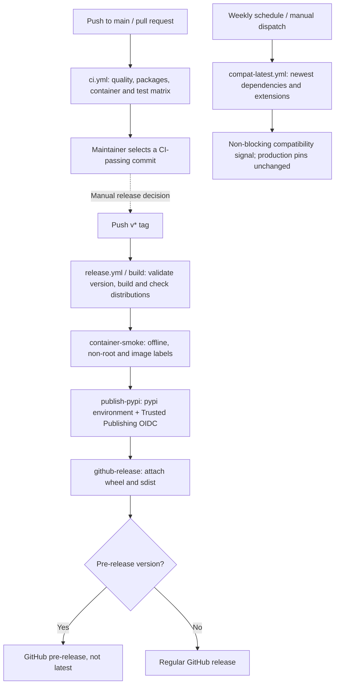

# Development, testing and delivery

[Documentation home](README.md) | [Implementation](implementation.md) | [Deployment](deploy/README.md)

## Set up the environment

```bash
git clone https://github.com/Didone/ducklake-iceberg.git
cd ducklake-iceberg
poetry install
poetry run ducklake-iceberg --version
```

Use Python 3.11-3.14 and Poetry 2.x; CI pins its Poetry version explicitly in
the workflows. Dependency versions come from `poetry.lock`. Do not replace
the lock with ad hoc `pip install --upgrade` inside a production/test
environment and assume it still represents CI.

SQLite tests need no database service. Docker-backed tests need a reachable
Docker daemon and permission to start containers/pull images. Extension
downloads need internet access unless preinstalled; a machine with blocked
network or a read-only HOME needs an appropriate extension directory.

No AWS credentials are needed for the default SQLite/moto tests. Do not run
experiments against production AWS while relying on a missing mock.
For local-only runs on a machine with AWS profiles, point `AWS_CONFIG_FILE` and
`AWS_SHARED_CREDENTIALS_FILE` to empty files, unset `AWS_PROFILE` and
`AWS_DEFAULT_PROFILE`, set fictitious `AWS_ACCESS_KEY_ID`/`AWS_SECRET_ACCESS_KEY`,
and set `AWS_EC2_METADATA_DISABLED=true`. This prevents ambient SSO refresh and
metadata credential discovery; tests that install their own fake profiles still
exercise profile selection and credential errors.
The shared integration harness uses two DuckDB threads for its small fixtures
and generated sync configurations. Explicit overrides and the native default
remain tested; the application's configuration default is unchanged.

## Standard commands

Run from the repository root:

```bash
# Required quality checks.
poetry check --lock
poetry run ruff check .
poetry run ruff format --check .
poetry run mypy

# Default CI-equivalent fast selection, with the global coverage gate.
poetry run pytest -m "not postgres and not e2e and not minio"

# Real PostgreSQL backend parity through testcontainers.
poetry run pytest -m postgres --cov-fail-under=0

# Real S3-compatible MinIO plus simulated Glue.
poetry run pytest -m minio --cov-fail-under=0
```

`--cov-fail-under=0` is appropriate for backend/subset runs, not a way to
remove the full fast suite's coverage requirement. `--no-cov` is convenient
when investigating one specific test.

```bash
poetry run pytest tests/sync/test_lock.py --no-cov
poetry run pytest tests/unit/test_config.py --no-cov
poetry run pytest tests/integration/test_export_initial_default.py \
  -m "not postgres" --no-cov
poetry run pytest -m "pins or roundtrip" --cov-fail-under=0
```

The last selection can include tests with additional backend requirements;
add `and not postgres` to the marker expression for a no-Docker run.
Use `poetry run pytest --collect-only -q` to inspect exactly what a
selection includes before running it.

## Test markers and what they guarantee

| Marker | Meaning and requirements |
| --- | --- |
| `integration` | Real DuckLake/catalog/files, normally SQLite with a parametrized PostgreSQL counterpart |
| `postgres` | PostgreSQL container through testcontainers; same behavioral suite as SQLite |
| `aws` | Simulated AWS APIs with moto; not evidence of real IAM/Lake Formation behavior |
| `minio` | End-to-end S3-compatible metadata storage in MinIO; Docker required; Glue remains simulated |
| `e2e` | Reserved for real-AWS tests; excluded from normal CI. A marker declaration does not provision an AWS environment or guarantee a currently checked-in real-AWS test exists. |
| `roundtrip` | Generated Iceberg artifacts read back through PyIceberg |
| `pins` | Verify exact DuckDB/PyIceberg and extension expectations |

`pyproject.toml` enables strict markers/configuration, warnings as errors,
coverage of `ducklake_iceberg`, terminal missing-line reporting and an 85%
coverage gate. Unknown markers and new warnings must be investigated, not
silenced globally.

## Fixtures and test doubles

### Global cleanup

[`tests/conftest.py`](../tests/conftest.py) resets process-level AWS
sessions/clients, FileIO cache, concurrency limits, timings, logging and
redaction counters before/after each test. Any new cache or mutable global
must have an equivalent isolation strategy. Otherwise a credential/mock
from one test can leak into the next.

### Catalog harness

[`tests/integration/conftest.py`](../tests/integration/conftest.py) defines
`CatalogHarness`:

- `write(*statements)` opens a fresh writer attachment and commits each SQL
  statement separately; setup roots use two threads.
- `settings(**overrides)` builds a validated application configuration.
- `meta_exec(sql)` deliberately modifies metadata to test impossible/corrupt
  states. This is a test escape hatch, **not operational repair guidance**.
- `catalog` parametrizes SQLite and PostgreSQL.
- `seeded_catalog` creates a table with inlined rows.
- `flushed_catalog` makes those rows available as files.
- `lake` supplies a file-backed source and an independent Iceberg target.
- Compound fixtures prepare schema, rows, options and flush through one owned
  bootstrap connection, closing it before the test. They keep fresh catalogs and
  statement-level commits; no read view or application connection is shared.
- One PostgreSQL service runs per pytest process; each case owns a fresh database,
  data/output paths and scoped `PG*` environment. Service readiness is checked once.
  Database teardown terminates retained idle clients; active work is cleaned up
  and reported as an error. The owned container stops at session teardown.
- `sync_config` only writes YAML. A scenario's source options belong in its
  explicit preparation SQL, alongside the table and data setup.

These are test-only classes/fixtures, not part of the production API.

### CLI and AWS simulation

Typer's `CliRunner` captures stdout/stderr and the process-like exit code.
Always assert both status and relevant structured contents. Rich may emit
ANSI styling when `FORCE_COLOR` is set; normalize presentation when testing
flag text, without weakening semantic assertions.

Moto simulates boto3 Glue/S3 calls. It does **not** transparently intercept
PyArrow's native S3 HTTP client. Local CLI integration tests use local
metadata paths and explicitly patch S3-only Glue location validation. That
patch is limited to tests.

The MinIO suite exercises actual S3-compatible FileIO and hashes source
files before/after operations. Its `Lake` helper wraps source writes,
syncs, source-tree hashes, bucket objects and reader comparisons. The
lifecycle case explicitly executes all seven original phases, including IAM,
resetting process state between phases. Run `test_complete_zero_copy_lifecycle`
individually or as part of the suite; it has no dependency on earlier pytest cases.

Set `DUCKLAKE_ICEBERG_MINIO_IMAGE` only when intentionally testing another
image; reproducibility otherwise relies on the test's pinned default.

## Where to add tests

| Change | Relevant existing tests |
| --- | --- |
| Settings/precedence/validation | `tests/unit/test_config.py` |
| Connection/error translation/extensions | `tests/integration/test_connection.py`, `test_extension_directory.py`, `tests/unit/test_connection_translate.py` |
| File enumeration/path identity | `tests/catalog/test_files.py` |
| Doctor rule/dependency behavior | `tests/doctor/`, `tests/integration/test_doctor_acceptance.py`, `test_rules.py` |
| Inlined data/flush/VARIANT | `tests/integration/test_detect.py`, `test_checkpoint.py`, `test_variant.py`, `test_revalidation.py` |
| Type/schema/partition mapping | `tests/mapping/`, `tests/integration/test_type_roundtrip.py`, `test_partition_names.py` |
| Added-column defaults and concurrent source writes | `tests/integration/test_export_initial_default.py`, `test_export_concurrent_inlined.py` |
| Delete visibility/writing | `tests/deletes/`, `tests/integration/test_deletes_reader.py` |
| Avro/statistics/sequences/counters/metadata | `tests/writer/` |
| Incremental reuse/idempotence/repair | `tests/integration/test_incremental.py`, `test_sync_e2e.py`, `tests/test_export_register.py` |
| Independent reader interoperability | `tests/integration/test_second_reader.py` |
| Lock/state/retry/divergence | `tests/sync/`, `tests/test_retry.py`, `tests/test_glue.py` |
| JSON/log contract and credential redaction | `tests/integration/test_envelope_contract.py`, `test_credentials_no_leak.py`, `tests/unit/test_observability.py` |
| Request budget/performance | `tests/integration/test_sync_budget.py`, `test_sync_performance.py` |
| IAM/deploy artifacts and release workflow | `tests/test_release_artifacts.py`, `tests/integration/test_e2e_minio.py` |

Test a behavior that would fail without your change. For metadata, assert
the read-back rows/IDs/deletes and live-set reconstruction, not just that
the generated file exists. Tests should preserve the same behavior on both
catalog backends.

## Debugging tests

1. Reproduce the smallest failing test with `--no-cov -vv`.
2. Read its fixtures: local paths, S3 endpoints, backend parametrization and
   mocks determine what is really exercised.
3. Use `--log-level DEBUG` / JSON stderr in CLI tests, without printing raw
   secret properties or bypassing redaction.
4. For container failures, verify Docker access and readiness. Skips are not
   proof that an integration path passed.
5. After a focused fix, run the related selectors together and quality
   checks. Broaden to the full fast/backend suite as needed by the change.

PostgreSQL tests start real catalog environments; a full parity job can take
tens of minutes. Do not interpret that alone as a deadlock or cancel it
merely because SQLite finished first.

## Dependency pins and extension changes

[`deps.py`](../src/ducklake_iceberg/deps.py) checks exact package versions
and DuckDB extension expectations, including hashes where recorded:

```bash
poetry run python -m ducklake_iceberg.deps --report-only
poetry run python -m ducklake_iceberg.deps
```

To bump a pin, update the manifest/lock and corresponding `deps.py`
expectations, inspect physical type/field-ID behavior, then run pins,
round trips, the full fast suite and backend checks. A same-version extension
rebuild may still differ by hash. Verify the origin and compatibility; do
not replace an expected hash just to make a check green.

## Continuous integration and releases

| Workflow | Trigger and purpose |
| --- | --- |
| [`ci.yml`](../.github/workflows/ci.yml) | Push to main/pull requests. Lock coherence, lint/format/mypy, wheel/sdist validation and clean installation, offline/non-root container smoke, fast suite on Python 3.11-3.14, PostgreSQL and MinIO on 3.12. |
| [`compat-latest.yml`](../.github/workflows/compat-latest.yml) | Weekly/manual non-blocking experiment against newest DuckDB/PyIceberg/extensions, optionally pre-releases/nightly extensions. Pin checks excluded intentionally; failures warn about future compatibility, not permission to change production pins. |
| [`release.yml`](../.github/workflows/release.yml) | A `v*` tag. Check version/changelog, build/validate/install artifacts, smoke-test container, publish to PyPI with OIDC, then create the GitHub release. Candidates are published to the same PyPI and marked GitHub pre-releases, not latest. |

The release workflow does not itself run the full CI test matrix.
Release a commit whose CI has passed.



The dashed link is release policy, not an automatic CI-to-tag workflow.
Final versions and candidates both go to real PyPI; a GitHub pre-release
flag does not select a separate package index.

Follow [CONTRIBUTING's release policy](../CONTRIBUTING.md#releasing).
Validate locally before tagging:

```bash
poetry check --lock
poetry build
poetry run twine check --strict dist/*
poetry run python scripts/check_release_version.py v0.1.0rc1 \
  --changelog CHANGELOG.md
poetry run pytest tests/test_release_artifacts.py --no-cov
```

Use the intended version in that command, `pyproject.toml` and the changelog.
Build into a clean output directory for release uploads so old distributions
are not accidentally included in `dist/*`. PyPI filenames/versions cannot
be overwritten.

Trusted Publishing must be configured for repository
`Didone/ducklake-iceberg`, workflow `release.yml`, GitHub environment `pypi`.
No PyPI API token is needed in the repository. New projects use a pending
publisher in the PyPI account settings; first successful publication creates
the project. This repository's current flow does not use TestPyPI.

After publication, install the exact version into a clean virtualenv from
PyPI, run `pip check`, `ducklake-iceberg --version` and `sync --help`, and
verify that the GitHub release has the correct pre-release status/assets.
Do not treat a successful build as evidence that publishing or installation
from the index also succeeded.


## Fresh-process local sync benchmark

`scripts/bench_sync_e2e.py` runs real CLI processes against real DuckLake/SQLite
and Parquet, with S3/Glue simulated by a loopback moto server. It needs the
`moto[server]` development extra. It isolates configuration and AWS endpoint
variables so inherited development settings cannot select a real catalog or
AWS endpoint. Fixtures and reader audits run outside the timer.

```bash
poetry run python scripts/bench_sync_e2e.py --help
```

Pass absolute `--baseline-exe` / `--candidate-exe`, their revision labels,
`--output` pointing to a new private directory, and optionally `--scenarios`.
Defaults: seed 42, five warmups and 100 samples in five blocks, 60-second timeout.
The parent may use Poetry; measured children invoke the executable directly.
Use installed revisions with the same pinned dependencies, and keep timed
commands serial. Existing output directories are never overwritten.

Each attempt gets an independent 100,000-row/eight-file/four-partition fixture.
N/I/A/F/D/U cover no-op, initial publication, append, inlined flush, delete and
update. The harness verifies expected exits, exact PyIceberg values, source
hashes, retained snapshots and no-op object/Glue stability. An installed DuckDB
Iceberg extension supplies a second reader audit; unavailable support is labeled
unverified. No extension installation is included in healthy measurements.

Artifacts: `manifest.json`, durable `samples.jsonl`, `summary.json`, `report.md`
and `validation.json`. All warmups/failures/timeouts remain visible; no outlier
trimming or automatic sample replacement. Output omits raw CLI payloads and
credentials. Results distinguish inclusive phases from wall time; the difference
from envelope duration is `outside_envelope_ms`, not pure startup. HTTP server
observations and SDK send hooks are separate views of the same requests, not
counts to add together. Local simulation cannot establish AWS latency/budgets.

The smaller `scripts/bench_sync.py` remains a quick p50/p95 diagnostic utility;
its repeated command runs do not establish isolated mutation cohorts.


For a third comparison arm, pass `--corrected-exe` and `--corrected-revision`
with the safety-fixed pre-optimization revision. Pair order is randomized across
all measured revisions. `scripts/bench_sync_validate.py OUTPUT_DIRECTORY`
rebuilds statistics and checks cohort counts, blocks, fixture equivalence and
candidate operation budgets from the durable ledger.

Supporting tools run **after** the reference batch, never concurrently:

- `scripts/bench_sync_diagnostics.py`: ten paired candidate control/traced
  attempts per scenario, sanitized server traces and incremental observer
  overhead. CLI counters remain enabled in both arms.
- `scripts/bench_sync_scale.py`: live-file/published-history combinations and
  optional million-row initial export; `--delta` measures a 1,000-row append
  instead of no-op. Preparation is untimed; each measured
  command is fresh. Characterization results remain separate from latency gates.
- `scripts/bench_sync_install.py`: empty temporary extension directories,
  installation timing and installed-build validation. Downloads require network
  access; unavailable installation remains visible instead of substituting
  preinstalled extensions.
